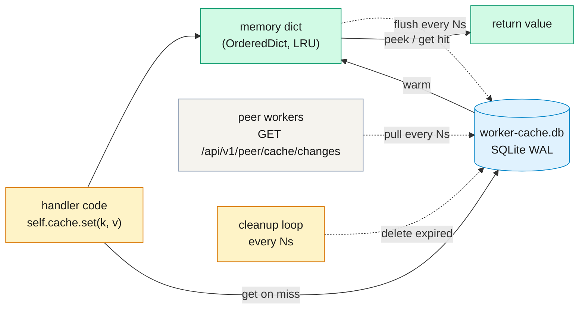
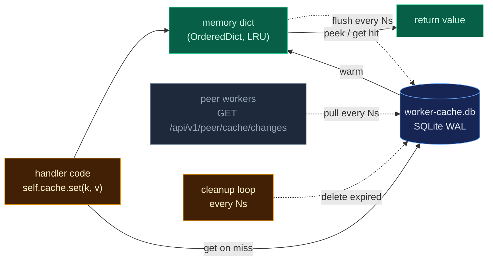

# Cache

A framework-provided key/value cache accessible as `self.cache` on every
handler. Memory-backed for hot reads, flushed to a per-worker SQLite file
via a periodic write-behind loop, and optionally shared across workers by
the [cache exchange](#cache-exchange): a periodic loop that pulls the
`cluster` and `global` rows of other workers over HTTP.

The cache is **opt-in** (`cache.enabled=false` by default). When disabled,
`handler.cache` is a no-op stub so handler code can call `self.cache.set(...)`
unconditionally — no `if self.cache is not None` guards.

---

## Quick reference

The handler-facing surface is five methods:

| Method | Sync? | What it does |
|--------|-------|--------------|
| `set(key, value, *, ttl=None, scope=CacheScope.LOCAL)` | sync | Store a value with optional TTL (seconds) and a scope that decides which peers may pull it. Memory write now; SQLite on the next flush cycle. |
| `await get(key, *, as_type=None)` | **async** | Lookup with memory → DB fallback; `None` on miss. `as_type=SomeModel` revives the JSON via `model_validate()` for a typed return. |
| `peek(key)` | sync | Memory-only probe, no DB fallback. TTL-aware, but a key that lives only on disk reports `None`. |
| `delete(key)` | sync | Drop from memory, schedule the DB-row deletion for the next flush. Returns `True` iff the key was in memory. Local-only — peers keep their copy. |
| `key in cache` | sync | TTL-aware membership check, memory only, no LRU bump. |

Rules of thumb:

- **`get` when you want the truth** — it is the only method that consults
  SQLite. `peek` and `in` see only what is already warm in memory.
- `get` is async by contract even when the cache is disabled (the no-op
  stub keeps the same signature), so call sites do not change between
  enabled and disabled states.
- For cross-worker invalidation **use TTL, never `delete`** — see
  [Delete is local-only](#delete-is-local-only-the-main-sharp-edge).
- The four sync methods are safe inside [`handler.offload()`](offload.md);
  `get()` is loop-only. Warm the keys you need with `get` *before*
  offloading, then `peek` inside the offloaded function.

Full semantics, metrics side effects, and sharp edges: see the
[API reference](#api-reference) below.

---

## What it solves

Before this feature, handlers that wanted to memoize subprocess results
had to hand-roll their own dict + TTL + eviction policy (see the pre-cache
integration demo). Each ad-hoc cache reinvented:

- Eviction when the dict grew unbounded
- Hit/miss counters and metrics
- TTL bookkeeping
- Durability across worker restarts
- Cross-worker visibility

Drakkar's cache gives you all of these for free, plus:

- `arrange()` can short-circuit tasks with
  [`PrecomputedResult`](handler.md#precomputed-task-results-skip-the-subprocess)
  built from a cache hit — skipping the subprocess entirely.
- Workers can share cached values through the
  [cache exchange](#cache-exchange) (eventually consistent, LWW).
- Operators inspect cache contents in the operator UI and scrape size/hit
  metrics via Prometheus.

---

## How it flows

<div class="diagram-light" markdown>

</div>

<div class="diagram-dark" markdown>

</div>

Three periodic loops run alongside the main processing pipeline, registered
as **system** periodic tasks (they appear with a `[system]` badge on the
UI's periodic tasks page alongside user-defined `@periodic` methods):

| Loop | Default interval | What it does |
|------|------------------|--------------|
| `cache.flush` | `flush_interval_seconds` (3s) | Drains the pending `_dirty` map to SQLite via `UPSERT` / `DELETE` in one transaction |
| `cache.sync` | `fleet.cache_exchange.interval_seconds` (30s) | Pulls new `cluster`/`global` rows from peer workers over HTTP and LWW-merges them into the local DB. See [Cache exchange](#cache-exchange) |
| `cache.cleanup` | `cleanup_interval_seconds` (60s) | Removes rows where `expires_at_ms < now_ms`; refreshes DB-size Prometheus gauges |

A reader aiosqlite connection is opened alongside the writer so `get()`
DB-fallback queries never queue behind a flush/sync/cleanup commit. WAL
mode lets the reader see consistent snapshots during concurrent writes.
The same reader serves the pages that peers pull from this worker.

---

## Minimal example: memoize a subprocess result

```python
import drakkar as dk
from drakkar import CacheScope

class MyHandler(dk.BaseDrakkarHandler[MyInput, MyOutput]):
    async def arrange(self, messages, pending):
        tasks = []
        for msg in messages:
            req = msg.payload
            cache_key = f'search|{req.pattern}|{req.file_path}'

            # Fast path: synchronous memory peek (no DB, no I/O)
            cached = self.cache.peek(cache_key)
            if cached is None:
                # Slower path: memory miss, check SQLite (local + pulled from peers)
                cached = await self.cache.get(cache_key)

            if cached is not None:
                # Skip the subprocess entirely — hand the result back directly
                tasks.append(dk.ExecutorTask(
                    task_id=dk.make_task_id('search'),
                    source_offsets=[msg.offset],
                    metadata={'request_id': req.request_id},
                    labels={'source': 'cache'},
                    precomputed=dk.PrecomputedResult(stdout=cached),
                ))
                continue

            # Cache miss: run the subprocess
            tasks.append(dk.ExecutorTask(
                task_id=dk.make_task_id('search'),
                args=[req.pattern, req.file_path],
                source_offsets=[msg.offset],
                metadata={'request_id': req.request_id},
                labels={'source': 'subprocess'},
            ))
        return tasks

    async def on_task_complete(self, result):
        # Persist the result back into the cache for next time.
        # Only genuine subprocess runs need this — precomputed hits are
        # already in the cache (that's where they came from).
        if result.pid is not None:
            meta = result.task.metadata
            cache_key = f'search|{meta["pattern"]}|{meta["file_path"]}'
            self.cache.set(
                cache_key,
                result.stdout,
                ttl=3600,           # 1 hour TTL
                scope=CacheScope.LOCAL,
            )
        # ... return CollectResult with sink payloads as usual
```

And the matching config:

```yaml
cache:
  enabled: true                 # the cache file lives in storage.dir
  flush_interval_seconds: 3.0
  cleanup_interval_seconds: 60.0
  max_memory_entries: 10000     # LRU cap; omit for unbounded
fleet:
  cache_exchange:
    enabled: true
    interval_seconds: 30.0
    page_size: 500                # rows per page pulled from a peer, 1-1000
    timeout_seconds: 5.0          # one request to a peer
    max_concurrent_peers: 4       # peers pulled at the same time
    # Upper bound on one exchange cycle. null (default) means
    # interval_seconds * 0.9, so the next tick never overlaps the current
    # one. An explicit value must stay strictly below interval_seconds
    # (config load fails otherwise, so a misconfiguration surfaces at
    # startup).
    cycle_deadline_seconds: null
```

---

## Cache exchange

Workers do not read each other's cache files. Each worker keeps its cache
file private in its own `storage.dir`, and pulls the rows of other workers
over HTTP. Every `fleet.cache_exchange.interval_seconds` (default 30) the
`cache.sync` loop asks each peer worth a pull for the `cluster` and
`global` rows that this peer originated, from
`GET /api/v1/peer/cache/changes`. The wire format is specified in
[Local Databases](local-databases.md#cache-exchange).

Nothing on the message path waits for the exchange: sources, the executor,
sinks and offset commits run the same with the exchange slow, failing or
off.

### Which peers are pulled

The peers come from the [fleet registry](fleet.md) snapshot. In each cycle
a peer is pulled only when all of these hold:

- The registry lists it. A worker the registry does not list is never
  pulled. With no registry (provider `none`, or the UI off) nothing is
  pulled.
- Its `online` is not `false`. `online: null` (liveness unknown) does not
  stop a pull.
- Its card `state` is not `starting`.
- Its card carries `features.cache`. A worker puts it on its card only
  while it serves the exchange: the cache, `storage.dir` and
  `fleet.cache_exchange` are on. Cards of the `static` provider come from
  the config and carry no `features` object at all: such a peer is pulled
  every cycle, without the mark check below. A `static` peer with the
  cache off answers 404 and backs off like any failing peer.
- It is not backing off after failures (see
  [Peer unreachable](#peer-unreachable)).
- One of the scopes asked of it has a card mark past this worker's cursor
  for it, so nothing is requested when nothing is new.

The scopes asked of a peer depend on its cluster (`cluster_name` on its
card): a peer of the same cluster is asked for `cluster` and `global`, any
other peer for `global` only. `local` rows never leave a worker. See
[Cross-cluster visibility](#cross-cluster-visibility).

The card mark is `features.cache` on the peer's card: for each scope, the
`(updated_at_ms, key)` of the newest row that peer originated. A worker
raises its marks after each committed flush and publishes them with its
next card heartbeat.

### Paging and cursors

A pull asks for pages of `fleet.cache_exchange.page_size` rows (default
500, 1 to 1000) after a `(updated_at_ms, key)` cursor, until the peer
answers `more: false`. A worker that restarts, or a peer with a large
backlog, therefore catches up in one cycle, unless the cycle deadline
cuts the pull; the next cycle continues from the cursor.

- Each page is applied in one transaction with the
  [LWW upsert](#consistency-model), and the memory entries of its keys are
  dropped so the next `get()` reads the merged value. The commit, the
  metrics and the memory step are protected from the cycle deadline as
  one unit.
- After a page is applied, the cursor moves to the page's last row. Rows
  that share one `updated_at_ms` across a page boundary are neither lost
  nor applied twice, because the cursor includes the key.
- After a complete pull (`more: false`), the cursor moves up to the card
  mark, so rows deleted or expired on the peer do not cause an empty pull
  every cycle.
- Cursors live in memory. A restarted worker pulls every peer from the
  start once; LWW rejects the rows it already has.

### Concurrency and the cycle deadline

At most `fleet.cache_exchange.max_concurrent_peers` peers (default 4) are
pulled at the same time; the others wait for a free slot. Each request
has a connect timeout of 2 seconds and a total timeout of
`fleet.cache_exchange.timeout_seconds` (default 5).

The whole cycle ends at `fleet.cache_exchange.cycle_deadline_seconds`
(default `0.9 x interval_seconds`). When the deadline fires, the worker
cuts the peers that are still pulling or still waiting for a slot. A cut
peer is **not** counted as a failure and does not back off; the pages it
already applied keep their cursor. The worker counts the cut cycle in
`drakkar_cache_peer_sync_timeouts_total`, logs
`cache_peer_sync_cycle_timeout`, and the periodic-task wrapper records the
run with `status=error`, so dashboards keyed on
`drakkar_periodic_task_runs_total{status='error'}` see it. The loop keeps
running: one deadline does not turn the exchange off.

### What a worker accepts

A worker applies only the rows that the peer itself originated
(`origin_worker_id` equals the peer's name on its card) and that have a
scope it asked for. Other rows are dropped, counted in
`drakkar_cache_sync_errors_total{peer}`, and logged once per peer per
cycle as `fleet_peer_rows_rejected` with the counts by reason (`scope`,
`origin`). These answers fail the whole request as `bad_body`: one that
is not the expected JSON shape, one larger than 64 MiB, and a page whose
rows are not strictly after the cursor and in `(updated_at_ms, key)` order
(a faulty peer cannot keep a pull looping). The timeout
`fleet.cache_exchange.timeout_seconds` covers the whole request, the body
included.

Peer requests go to the URL on the peer's card (`ui.public_url`, else
`http://<outbound ip>:<ui.port>/`). They ignore the proxy environment
variables and do not follow redirects. So every worker must reach the
UI port of its peers at that URL: across hosts, bind `ui.host` to an
address peers can reach, or set `ui.public_url`.

The serving route needs no token, even with `ui.auth_token` set; see
[Security posture](security.md) for what that exposes.

---

## API reference

```python
class Cache:
    def set(
        self,
        key: str,
        value: Any,
        *,
        ttl: float | None = None,
        scope: CacheScope = CacheScope.LOCAL,
    ) -> None: ...

    def peek(self, key: str) -> Any | None: ...
    def delete(self, key: str) -> bool: ...
    def __contains__(self, key: str) -> bool: ...

    async def get(
        self,
        key: str,
        *,
        as_type: type[T] | None = None,
    ) -> Any | None: ...
```

**Thread-safety.** The four sync operations (`set` / `peek` / `delete` /
`in`) are safe to call from functions running under
[`handler.offload()`](offload.md) — the cache guards its memory state
with an internal lock, so a pool thread and the event loop can use the
same cache concurrently. The async `get()` stays **loop-only** (its
SQLite fallback rides a connection bound to the main loop): `await` it
for the keys you need *before* offloading, which warms them into memory,
then `peek` inside the offloaded function.

### `set(key, value, *, ttl=None, scope=CacheScope.LOCAL)`

Stores `value` under `key` in the in-memory dict and schedules a flush to
SQLite on the next flush cycle. Synchronous — no I/O happens at call time.

`value` can be any JSON-serializable primitive (`str`, `int`, `float`,
`bool`, `None`, `list`, `dict`) or a Pydantic `BaseModel`. Pydantic models
are serialized via `model_dump_json()`. Anything else raises `TypeError`
at `set()` time (deliberately — clearer error now than a silent failure
on a peer that can't parse the value later).

`ttl` is in **seconds** (fractional OK). `None` means "never expires"
(the entry will remain until explicitly deleted or the worker's cache DB
is wiped).

`scope` controls how far the entry reaches — from process memory
(`MEMORY`) to every peer (`GLOBAL`). See [CacheScope](#cachescope) below.

### `peek(key)`

Memory-only lookup. Returns the decoded value if the key is in memory
and unexpired; `None` otherwise. Never hits the DB — intended for
`arrange()`'s hot path where you want zero I/O.

`peek` bumps the key to MRU position in the LRU order. Expired entries
are opportunistically evicted.

!!! note "peek() is NOT counted in hit/miss metrics"
    `drakkar_cache_hits_total` and `drakkar_cache_misses_total` are
    incremented by `get()` only. `peek()` is a memory probe — counting
    it would double-count if a caller does peek-then-get.

### `async get(key, *, as_type=None)`

Async lookup with DB fallback. Lookup order:

1. **Memory hit** — key in `_memory` and unexpired → return without DB
   access. LRU-bump.
2. **DB fallback** — memory miss → SELECT on the reader connection,
   filtered by `expires_at_ms IS NULL OR expires_at_ms > now`.
3. **Warm memory** — DB hit → rebuild the entry in `_memory` at MRU
   position (may trigger LRU eviction if `max_memory_entries` is set).

`as_type=SomeModel` revives the JSON value via `SomeModel.model_validate()`
for typed return. Without it, `get` returns the raw `json.loads` result
(primitives / lists / dicts).

Increments `drakkar_cache_hits_total{source="memory"}` on memory hit,
`drakkar_cache_hits_total{source="db"}` on DB hit,
`drakkar_cache_misses_total` on miss.

### `delete(key)`

Removes the key from memory and schedules a DB row deletion on next
flush. Returns `True` if the key was present in memory, `False` otherwise.

!!! warning "Delete is local-only — use TTL for cross-worker invalidation"
    `delete(key)` removes the row from **this worker's** cache DB. Peers
    that already pulled the value keep their copy until it expires via
    TTL or is overwritten. Worse, the deleted key can **come back**:
    when the worker that originated the key writes it again, or when
    this worker restarts (its exchange cursors live in memory, so it
    pulls every peer from the start once), the next pull brings the
    peer's row back and LWW accepts it.

    For cross-worker invalidation, **use TTL** — set a short TTL when
    writing, or overwrite with a dummy/tombstone value. True delete
    propagation would require tombstone rows and GC, which is out of
    scope for v1.

### `__contains__(key)`

`key in self.cache` — returns `True` if the key is in memory and
unexpired. Does **not** bump LRU position (membership is a probe, not an
access). Does not consult the DB.

### CacheScope

```python
class CacheScope(StrEnum):
    MEMORY = 'memory'     # this worker's memory only; never flushed to SQLite
    LOCAL = 'local'       # this worker only; peers never pull
    CLUSTER = 'cluster'   # same-cluster peers pull it through the exchange
    GLOBAL = 'global'     # all peers (any cluster) pull it through the exchange
```

The scopes form a reach ladder — each step widens where the entry can
travel: process memory → this worker's DB file → same-cluster peers →
all peers.

For the persisted scopes, the scope decides which peers may pull an entry
from this worker through the [cache exchange](#cache-exchange):

- A peer of the same cluster pulls `cluster` and `global` entries.
- A peer of another cluster pulls `global` entries only.
- `local` entries never leave this worker.

`MEMORY` entries never reach the DB at all. A `MEMORY` set stores the
value in memory and records a **delete tombstone** for the key instead
of a write — so if an earlier wider-scoped `set` left a row on disk,
the next flush purges it. This keeps the invariant "a `MEMORY` key never
serves disk data": without the tombstone, an LRU eviction or a worker
restart would let `get()` resurrect the stale persisted value. The
flip side: `MEMORY` entries are lost on eviction and restart — see
[the edge case below](#memory-entries-are-volatile-and-invisible-to-the-entries-browser).

---

## Choosing a scope

| Scope | Use when | Example |
|-------|----------|---------|
| `MEMORY` | Hot, cheap-to-recompute values that should never touch disk; also values too churn-heavy to be worth flush traffic | Per-worker negative-lookup markers; request-coalescing flags with sub-second TTL |
| `LOCAL` | Per-worker results that peers will compute independently (or that are worker-specific) | Hot-path subprocess memoization; per-worker rate limit counters |
| `CLUSTER` | Expensive results worth sharing across workers in the same deployment | Regex match results over a shared corpus; enrichment lookups |
| `GLOBAL` | Results universal across clusters (rare — usually signals "this is really a DB sink") | Cross-deployment config distribution (unusual) |

When unsure, start with `LOCAL`. The default is `LOCAL` specifically
because it's the safe choice — LOCAL entries stay put, peers never see
them, and if you later decide to share, you flip the scope on new
writes without touching consumers.

---

## Cache vs. real DB sink vs. compute-every-time

| Question | Choose... |
|----------|----------|
| "Do I need this value to survive a cluster-wide crash?" | **DB sink** (Postgres, Redis with persistence). Cache entries live in per-worker SQLite files with TTL retention — fine for optimization, not for durability-critical state. |
| "Is recomputation cheap (< subprocess launch cost)?" | **Compute every time.** A 50us Python function is not worth caching. |
| "Is recomputation expensive, and would it be OK to recompute on a cold cache?" | **Cache.** Cold start is bounded by whatever time it takes for reasonable cache population via normal traffic. |
| "Do I need strict consistency across workers?" | **Not cache.** Cache is eventually consistent (exchange lag + LWW + no tombstones). Use Redis / Postgres / a distributed consensus system. |
| "Is the value small, JSON-serializable, and idempotent?" | **Cache fits well.** |
| "Does the value contain secrets?" | **Not cache.** `cluster` and `global` values are served without a token to anyone who can reach the UI port, and the `/debug/cache` entries browser shows every persisted value. No redaction layer applies to cache values. |

---

## Edge cases and sharp edges

### Cold cache on worker restart

When a worker restarts, its in-memory dict is empty. The DB file
(`<worker>-cache.db`) still has all the entries, so `get()` will
lazily warm memory on first access per key. There is **no eager
preload** on startup — adding it would stall startup and race with
normal traffic. This is deliberate (YAGNI: normal traffic warms the
cache within one flush cycle).

The exchange cursors live in memory, so a restarted worker also pulls
every peer from the start once. It pages until each peer answers
`more: false`, so it catches up in one cycle unless the cycle deadline
cuts it. Expired rows are not served, and LWW rejects rows that are not
newer — no runaway work.

### TTL vs. delete

**TTL is the recommended invalidation mechanism.** Set a TTL when
writing; never call `delete` unless you mean "remove this from my own
worker's memory, and peers may still have it."

Reasoning: peers who pulled a value before a `delete` keep their copy.
When the originating worker writes the key again, or when your worker
restarts and pulls from the start, the value comes back into your DB via
LWW. TTL naturally expires everywhere (every worker runs its own cleanup
loop, and a peer never serves an expired row).

### Peer unreachable

Each peer is pulled in its own task, so one bad peer cannot break the
cycle, and the worker keeps running. A request fails on a timeout, a
refused connection or another transport error, any status other than
`200`, or an answer that is not the expected JSON shape. A failed
request:

- counts one error in `drakkar_cache_sync_errors_total{peer}` and one
  request in `drakkar_fleet_peer_requests_total{endpoint="cache_changes", outcome}`
  (`timeout`, `transport_error`, `http_error` or `bad_body`);
- makes the worker skip that peer for 1, 2, 4, 8, then 16 cycles (16 for
  every further failure in a row); one successful pull resets it;
- logs `fleet_peer_request_failed` (warning) once at the start of a run of
  failures, and `fleet_peer_backoff` (info) at each failure, with the
  cycles to skip.

A page that arrives but cannot be applied to the local file logs
`cache_peer_sync_failed` and counts one error, but does not back the peer
off: the fault is local. Each peer has its own cursor, and pages applied
before a failure keep it, so the next pull continues from there.

### Cross-cluster visibility

The exchange takes each peer's cluster from its card in the
[fleet registry](fleet.md). Workers are grouped by `cluster_name` (from
`DrakkarConfig.cluster_name` or `cluster_name_env`).

The scopes asked of a peer depend on cluster membership:

- Peer in same cluster as self → `cluster` and `global`
- Peer in different cluster → `global` only

Unclustered workers (`cluster_name=''`) are treated as a single
implicit cluster — they pull cluster-scoped entries from other
unclustered workers, and global-scoped entries from anyone.

A worker the registry does not list is never pulled, whatever its
cluster. With no registry, nothing is pulled.

### LRU eviction

`max_memory_entries=10_000` (**default**) → the in-memory dict is capped at
10,000 entries. Production-safe default — prevents unbounded growth under
write-heavy workloads. Entries beyond the cap are evicted LRU, with pending
dirty-ops preserved (see below).

`max_memory_entries=None` → the in-memory dict grows unbounded. Set this
explicitly only when you have a bounded key universe or your own eviction
strategy. The config layer emits a `cache_max_memory_entries_unbounded`
warning at startup so the intentional choice is visible in logs — unlike the
default, this knob needs operator awareness.

When the cap is set and adding the N+1-th entry would exceed it, the
**least-recently-used** key is popped from the dict. Its pending dirty-op
(if any) is **preserved** — the DB is the source of truth, and losing a
dirty SET before flush would silently drop the write.

Evicted keys fall through to the DB on the next `get()`, which warms
memory again (and may evict a different key in turn). The
`drakkar_cache_evictions_total` counter tracks churn — a sustained
high rate means the cap is undersized for the working set.

### MEMORY entries are volatile (and invisible to the entries browser)

`CacheScope.MEMORY` trades durability for zero disk traffic. Three
consequences, all by design:

- **LRU eviction loses the entry.** Persisted scopes fall through to
  the DB after an eviction and re-warm on the next `get()`; a `MEMORY`
  entry has no DB row, so once evicted the next read is a plain miss.
  Best-effort under memory pressure.
- **A worker restart loses all MEMORY entries.** Same reason — there is
  nothing on disk to warm from.
- **The `/debug/cache` entries browser never lists them.** The browser
  reads the cache DB file; `MEMORY` entries exist only in the process
  dict. They are still counted in the page's in-memory header stats
  and in the `entries_in_memory` / `bytes_in_memory` gauges.

Re-scoping a key **to** `MEMORY` purges its disk row on the next flush
(the tombstone described in [CacheScope](#cachescope)); re-scoping back
to a persisted scope resumes normal flushing. Peers that pulled a
wider-scoped value before the re-scope keep their copy until its TTL
expires — the same local-only limitation as `delete`.

### Secrets in cache values

The recorder redacts secrets before writing `worker_config`
([see the warning in Observability](observability.md#worker_config-autodiscovery)).
The cache does **not** apply such redaction: cache values are written
verbatim. The `/debug/cache` entries browser shows every persisted value
(behind `ui.auth_token` when one is set). `cluster` and `global` values are
also served by `GET /api/v1/peer/cache/changes`, which needs no token, to
anyone who can reach the UI port of a worker that serves the exchange. Do
not put secrets in the cache.

### Delete is local-only (the main sharp edge)

Repeated here because it's the single behavior most likely to surprise.
See [`delete()` above](#deletekey) for the full story.

**Rule of thumb:** for cross-worker invalidation, **use TTL**, not
`delete`.

---

## Consistency model

- **`MEMORY` scope opts out of all of this.** Memory-scoped entries are
  process-local: no durability window, no peer visibility, no LWW —
  they live and die with the worker process. Everything below concerns
  the persisted scopes.
- **Eventually consistent** across workers. A `set()` on worker A
  reaches worker B in four steps: A flushes it, A publishes its new card
  mark with the next registry heartbeat, B refreshes its registry
  snapshot, and B runs its next exchange cycle.
- **Worst-case staleness**, concretely: local durability is bounded by
  `flush_interval_seconds` (default 3s); cross-worker freshness is
  bounded by `flush_interval_seconds + fleet.registry.heartbeat_seconds +
  fleet.registry.refresh_seconds + fleet.cache_exchange.interval_seconds`
  (default 3s + 10s + 15s + 30s = 58s), when the pull succeeds. Size
  intervals based on your tolerance — shorter intervals trade more SQLite
  writes, card writes and peer requests for tighter staleness. The cache
  never promises stricter consistency than those intervals; anything
  that needs real consistency should use a real DB sink, not this cache.
- **LWW (last-write-wins)** by `updated_at_ms`, with lexicographically
  smaller `origin_worker_id` as the tiebreaker for equal timestamps.
  Identical SQL (`LWW_UPSERT_SQL`) is used by local flushes and by the
  pages pulled from peers, so local and cross-worker paths cannot
  diverge.
- **No relays.** A worker serves only the rows it originated. A worker
  that starts after another worker has gone never gets the gone worker's
  rows, even when a third worker still holds them.
- **Expiry uses the serving worker's clock.** A peer serves a row while
  the row is unexpired on the peer's own clock.
- **A late flush can be missed.** The cursor moves by
  `(updated_at_ms, key)`. When a peer flushes a row after this worker has
  already pulled a row with a higher `(updated_at_ms, key)` from that
  peer, this worker never pulls the late row.
  `set()` takes its timestamp when it is called, so a `set()` from a
  [`handler.offload()`](offload.md) thread can be flushed after a newer
  `set()` from the event loop and produce such a row.
- **No tombstones in v1.** `delete` is local-only. Use TTL.
- **Durability window** = `flush_interval_seconds` (default 3s). A
  worker crash between `set()` and the next flush loses the
  unflushed writes. Tune shorter for stricter durability at the cost
  of more SQLite transactions.
- **Wall-clock dependent.** LWW compares `updated_at_ms` across
  workers, which assumes NTP-sync'd hosts. Wall-clock skew of a few
  seconds is fine; multi-minute skew would break LWW fairness.
- **`size_bytes` is UTF-8 byte length.** The in-memory ``bytes_in_memory``
  gauge (and its DB counterpart ``bytes_in_db``) sum the **byte length
  of the JSON-encoded value** (`len(json_text.encode('utf-8'))`) — not
  the Python-object size, not character count. Non-ASCII characters
  cost 2–4 bytes each. When sizing capacity from the gauge, budget
  against UTF-8 byte counts: a 100-char Cyrillic string costs 200
  bytes, not 100.

---

## UI walkthrough

When `cache.enabled=true`, the operator UI gains a **Cache** nav link that
opens `/debug/cache`.

### `/debug/cache` — entries browser

- Header stats: in-memory entries / bytes, DB entries / bytes
- Filter bar: scope dropdown, key search (case-sensitive substring
  match), "show only expired" toggle
- Paginated table of entries (limit default 200, max 1000): key,
  scope, size, age, TTL remaining, origin worker
- Side panel on click: decoded JSON value + full metadata
  (created_at, updated_at, expires_at, origin_worker_id)

The table lists the cache **DB file**, so `MEMORY`-scoped entries never
appear in it — they show up only in the in-memory header stats. See
[the edge case above](#memory-entries-are-volatile-and-invisible-to-the-entries-browser).

### `/debug/periodic` — system periodic tasks

The existing periodic tasks page now shows `cache.flush`, `cache.sync`,
and `cache.cleanup` alongside user-defined `@periodic` methods, each
with a small `[system]` pill indicating framework origin. Status, last
run, duration, success/error counts, and sparkline of recent runs are
rendered identically to user periodic tasks — the `[system]` pill is
the only visual difference.

### Prometheus metrics page

All [cache metrics](observability.md#cache) appear on the `/debug`
metrics viewer alongside the rest of the framework metrics.

### Message Probe tab — cache is read-only

The **Message Probe** tab on `/debug` runs a pasted message through the
full handler pipeline without touching production state. In this mode
**all cache writes are silently suppressed** (`set`, `delete`) — the
probe's `DebugCacheProxy` records every call but never mutates the live
cache. Reads are **opt-in** via the *Use cache (read-only)* checkbox: when
enabled, `get` / `peek` / `__contains__` forward to the real cache and
show accurate hit/miss outcomes in the call log; when disabled, all reads
return a miss even for keys that exist. Every call (including suppressed
writes) is captured with `op`, `key`, `scope`, `outcome`, and the
originating hook stage, so the probe report lets you audit what the
handler asked of the cache without disturbing its state.

---

## Related pages

- [Handler](handler.md) — the handler class surface that exposes `self.cache`
- [PrecomputedResult](handler.md#precomputed-task-results-skip-the-subprocess)
  — how cache hits short-circuit tasks
- [Observability](observability.md) — Prometheus metrics, operator UI details
- [Performance](performance.md) — when caching helps, the `PrecomputedResult`
  fast path
- [Fleet registry](fleet.md) — where the cache exchange finds its peers:
  their URL, cluster, state, liveness and card marks
- [Local Databases](local-databases.md#cache-exchange) — the cache file
  and the wire format of the exchange
- [Security posture](security.md) — what the public peer route exposes
- [Integration Tests](integration.md) — the docker-compose demo exercises
  cache fast-path, the cache exchange, and disk persistence
