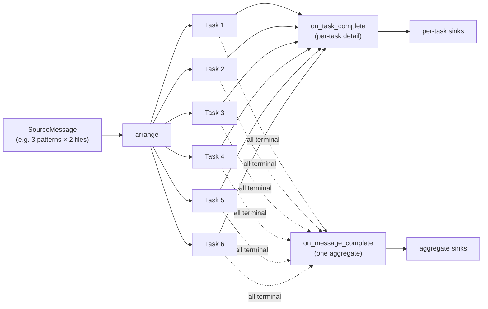

# Fan-out: One Message → Many Tasks → One Aggregate

A common pipeline shape: one incoming message describes work that must be
split into many subprocess invocations, and the useful output is a
**single aggregated record** over all those subprocess outcomes — not
one output per task.

Drakkar supports this natively via the `on_message_complete` hook and
the `MessageGroup` dataclass. When one message makes so many tasks that they
should not all exist at once, the handler can yield them in groups with
`arrange_stream()` instead (see [Streaming a large message](#streaming-a-large-message)).
The [Pipeline Map](pipeline-map.md) compares `arrange()`, `arrange_stream()`
and the HTTP source side by side, with the outcome of each failure.

!!! info "When to use this page"
    If your pipeline is strictly 1-in / 1-out (one input → one subprocess
    → one output), you don't need any of this — use `on_task_complete`
    and ignore the rest of the page. This page is for pipelines where
    one input deliberately produces *several* subprocess tasks.

---

## The shape



- `arrange()` expands the input into N tasks (the fan-out)
- `on_task_complete(result)` fires **once per task** — typical per-task fanout
- `on_message_complete(group)` fires **once per source message**, after every
  task derived from it has reached a terminal state

The two hooks are independent. You can use both, either, or neither.

---

## The `MessageGroup` passed to `on_message_complete`

```python
class MessageGroup(BaseModel):
    source_message: SourceMessage  # the original Kafka message
    tasks: list[ExecutorTask]  # full history (see below)
    results: list[ExecutorResult]  # terminal successes
    errors: list[ExecutorError]  # terminal failures (SKIP / retries exhausted)
    started_at: float  # monotonic, when arrange() scheduled first task
    finished_at: float  # monotonic, when last task terminal'd

    # Convenience properties
    succeeded: int  # len(results)
    failed: int  # len(errors)
    total: int  # len(tasks) — includes REPLACED tasks (see below)
    replaced: int  # total - succeeded - failed
    all_succeeded: bool  # True iff total > 0 and failed == 0
    any_failed: bool  # failed > 0
    is_empty: bool  # total == 0 (arrange() returned nothing)
    duration_seconds: float
```

### What counts as "terminal"?

A task is **terminal** when its outcome is decided:

| Outcome | Contributes to |
|---|---|
| Subprocess exit 0, `on_task_complete` ran | `results` |
| `on_error` returned `SKIP` | `errors` |
| `on_error` returned `RETRY`, retries exhausted | `errors` |
| `on_error` returned `list[ExecutorTask]` (replaced) | **neither** — the replacements take its place |
| Unexpected exception in `on_task_complete` | `errors` (synthesised) |

Replaced-original tasks are kept in `tasks` (full history for debugging)
but not counted in `results` or `errors`. The REPLACEMENTS eventually
land in `results` or `errors` as their own terminal outcomes.

You can always recover the replacement count:

```python
group.replaced == group.total - group.succeeded - group.failed
```

### Tracing the replacement chain

Every task the framework schedules in response to an `on_error` list-return
has its `parent_task_id` auto-populated with the failing task's `task_id`
(unless the handler explicitly set it). In `on_message_complete` you can
walk the chain upward to find the arrange()-produced root:

```python
async def on_message_complete(self, group):
    by_id = {t.task_id: t for t in group.tasks}
    for task in group.tasks:
        chain = [task]
        while chain[-1].parent_task_id:
            chain.append(by_id[chain[-1].parent_task_id])
        # chain[0] is this task; chain[-1] is the original arrange() task
```

---

## A minimal example

```python
from pydantic import BaseModel, Field
import drakkar as dk


class SearchRequest(BaseModel):
    request_id: str
    patterns: list[str] = Field(min_length=1)
    file_paths: list[str] = Field(min_length=1)


class PerTaskResult(BaseModel):
    request_id: str
    pattern: str
    file_path: str
    match_count: int


class RequestSummary(BaseModel):
    request_id: str
    total_tasks: int
    succeeded: int
    failed: int
    total_matches: int


class MyHandler(dk.BaseDrakkarHandler[SearchRequest, PerTaskResult]):
    async def arrange(self, messages, pending):
        # One message → patterns × files tasks. Every produced task
        # shares the message's source_offsets — this is what binds them
        # into a MessageGroup.
        tasks = []
        for msg in messages:
            req = msg.payload
            for pattern in req.patterns:
                for file_path in req.file_paths:
                    tasks.append(
                        dk.ExecutorTask(
                            task_id=dk.make_task_id('search'),
                            args=[pattern, file_path],
                            metadata={
                                'request_id': req.request_id,
                                'pattern': pattern,
                                'file_path': file_path,
                            },
                            source_offsets=[msg.offset],
                        )
                    )
        return tasks

    async def on_task_complete(self, result):
        """Fine-grained per-task output (optional)."""
        meta = result.task.metadata
        matches = sum(1 for line in result.stdout.split('\n') if line)
        per_task = PerTaskResult(
            request_id=meta['request_id'],
            pattern=meta['pattern'],
            file_path=meta['file_path'],
            match_count=matches,
        )
        return dk.CollectResult(
            kafka=[dk.KafkaPayload(data=per_task, key=meta['request_id'].encode())],
        )

    async def on_message_complete(self, group):
        """Called ONCE per SearchRequest, after all its tasks finished."""
        req: SearchRequest = group.source_message.payload
        if req is None or group.is_empty:
            return None

        total_matches = sum(sum(1 for line in r.stdout.split('\n') if line) for r in group.results)

        summary = RequestSummary(
            request_id=req.request_id,
            total_tasks=group.total,
            succeeded=group.succeeded,
            failed=group.failed,
            total_matches=total_matches,
        )

        # One aggregate record per request to a "summaries" topic.
        return dk.CollectResult(
            kafka=[
                dk.KafkaPayload(
                    data=summary,
                    key=req.request_id.encode(),
                    sink='summaries',
                ),
            ],
        )
```

---

## Offset commit semantics

Offsets are committed **per source message**, after `on_message_complete`
returns. This means:

- A fast message whose tasks finish quickly commits its offset immediately,
  even if another (slow) message in the same arrange() window is still
  in flight.
- If `on_message_complete` raises, the exception is logged and offsets
  commit anyway — the raise doesn't stall the partition.
- On crash / revoke before `on_message_complete` completes, the offset
  is NOT committed. The message replays on restart (at-least-once).
  Any partial side effects already delivered via `on_task_complete` are
  duplicated on replay; design downstream sinks to be idempotent (use
  `request_id` as a primary/dedup key).

!!! tip "At-least-once, not exactly-once"
    Replays can cause duplicates in the per-task sinks. The message-level
    aggregate in `on_message_complete` is at-least-once too: a crash
    between "aggregate delivered to Kafka" and "offset committed to Kafka"
    produces a duplicate aggregate on replay. If this matters, dedupe
    downstream by `(request_id, partition, offset)`.

---

## Choosing which hook(s) to implement

| Your shape | Use |
|---|---|
| 1 message → 1 task → 1 output | just `on_task_complete` |
| 1 message → N tasks → N outputs | just `on_task_complete` |
| 1 message → N tasks → **1 aggregate output** | `on_message_complete` only (return `None` from `on_task_complete`) |
| 1 message → N tasks → N detail + 1 aggregate | BOTH `on_task_complete` and `on_message_complete` |
| Multi-message batch metrics | `on_window_complete` (coarser than message-level) |
| 1 message → thousands of tasks, in independent parts | `arrange_stream()` with `on_group_complete` per part and `on_message_complete` for the whole (see [Streaming a large message](#streaming-a-large-message)) |

All three hooks coexist — they fire on the same underlying data but at
different granularities. Which to use is a choice about what you want
downstream consumers to see, not a framework constraint.

### `on_message_complete` vs `on_window_complete`

| | `on_message_complete` | `on_window_complete` |
|---|---|---|
| Fires for | one source message | one arrange() batch |
| Receives | `MessageGroup` | `list[ExecutorResult]`, `list[SourceMessage]` |
| Granularity | per-message | per-window (may span many messages) |
| Offset commit order | **before** commit | **after** some offsets may already be committed |
| Typical use | request-level aggregation | dashboard metrics, window-level logs |

---

## Error handling across the group

The group doesn't need every task to succeed to fire. The hook ALWAYS
fires when all tasks reach a terminal state, whether that's success or
failure. Decide what to emit based on the group's shape:

```python
async def on_message_complete(self, group):
    if group.is_empty:
        # arrange() returned nothing for this message — you may still
        # want to emit an audit record so the request isn't invisible.
        return self._emit_skipped(group.source_message)

    if group.all_succeeded:
        return self._emit_success_aggregate(group)

    if group.any_failed and group.succeeded == 0:
        # Every task failed — emit a dead-letter-style summary.
        return self._emit_total_failure(group)

    # Partial failure: some succeeded, some didn't.
    return self._emit_partial_aggregate(group)
```

### Replacement chains

`on_error` returning a replacement list is a common pattern for
"subdivide a failed task into smaller work." The replacements become
part of the same `MessageGroup` automatically — the group doesn't
complete until every replacement (and any *further* replacements from
their failures) settles.

```python
async def on_error(self, task, error):
    if error.exception and 'memory' in (error.exception or '').lower():
        # Split the file in half and try each part as a smaller task.
        return [
            dk.ExecutorTask(
                task_id=dk.make_task_id('half1'),
                args=[...],
                source_offsets=task.source_offsets,  # REQUIRED: inherit
            ),
            dk.ExecutorTask(
                task_id=dk.make_task_id('half2'),
                args=[...],
                source_offsets=task.source_offsets,
            ),
        ]
    return dk.ErrorAction.SKIP
```

!!! warning "Replacements must inherit `source_offsets`"
    A replacement task with empty or different `source_offsets` will not
    be tracked by the original message's `MessageGroup`. Copy
    `task.source_offsets` onto every replacement unless you deliberately
    want to detach it.

    The framework auto-populates `parent_task_id` so you can trace the
    chain later; `source_offsets` is the handler's responsibility.

### Replacement accounting — Window vs MessageGroup

The framework tracks tasks in two overlapping accounting structures and
it is worth knowing how each treats a replaced original.

**`MessageGroup`** (delivered to `on_message_complete`):

- `tasks` — full history: original + every replacement. `len(tasks) == total`.
- `results` — **terminal successes only**. Original that was replaced is
  NOT here; the successor's success lands here.
- `errors` — **terminal failures only** (SKIP or retries exhausted).
  A replaced original is also NOT here — it wasn't a terminal failure,
  it was replaced.
- `replaced` — the delta: `total - succeeded - failed`. This is where
  replaced originals show up.

So `MessageGroup` cleanly separates the three outcome classes, and
`group.total == group.succeeded + group.failed + group.replaced` always.

**`window.results`** (delivered to `on_window_complete` as the first arg):

This is a slightly different beast. It contains the **`ExecutorResult`
of every task invocation that reached a terminal outcome** — both
successes AND subprocess-level failures (non-zero exit code that ended
in SKIP or retries-exhausted). Replaced originals do NOT contribute an
entry.

Concrete example:

| Scenario | `total_tasks` | `len(results)` delivered to `on_window_complete` |
|---|---|---|
| 1 task, success | 1 | 1 (the success) |
| 1 task, fails → SKIP | 1 | 1 (the failure result) |
| 1 task, fails → RETRY exhausted | 1 | 1 (the final retry's failure result) |
| 1 task, fails → replaced by 2, both succeed | 3 | 2 (just the replacements — original omitted) |
| 1 task, fails → replaced by 1, replacement also fails → SKIP | 2 | 1 (replacement's failure; original omitted) |
| 2 tasks, one succeeds, one fails → replaced by 1 that succeeds | 3 | 2 (first success + replacement success) |

The rule of thumb: **`window.results` has one entry per actually-executed
task invocation that did not hand off to a replacement.** `total_tasks`
counts the full schedule. The gap between them equals the number of
replaced originals.

```python
async def on_window_complete(self, results, source_messages):
    # `len(results)` is the count of outcomes — NOT necessarily the
    # count of originally-scheduled tasks. If you need the total,
    # prefer summing `group.total` across MessageGroups in
    # `on_message_complete`, which is always consistent.
    for r in results:
        # Each `r` is an ExecutorResult from a real subprocess run.
        ...
```

!!! note "Collected only when the hook is implemented"
    Both collections cost real memory — a result holds the subprocess
    output — and a window holds them until its last task settles. The
    framework therefore fills `window.results` only for a handler that
    implements `on_window_complete`, and a `MessageGroup`'s `tasks` /
    `results` / `errors` only for one that implements
    `on_message_complete`. Counters, metrics and the recorder events are
    unaffected either way. The kept output counts in
    `executor.max_pending_bytes` until the hook has run. See
    [Performance](performance.md#what-the-completion-hooks-cost).

!!! note "The message and window hooks see tasks without stdin"
    When a task reaches its last outcome — after `on_task_complete` and
    its delivery, or after `on_error` with no retry — the framework sets
    `task.stdin` to `None`. `arrange()`, `on_error` (a replacement can be
    built from `task.stdin`), the retry run and `on_task_complete` still
    see the stdin; `on_message_complete` and `on_window_complete` see
    `None`. Keep what you need from the stdin in `task.metadata`. A task
    object scheduled more than once (returned twice by `arrange()`, or
    returned by `on_error` as its own replacement) keeps its stdin until its
    last run settles.

!!! info "Why omit the replaced original?"
    Semantically, an `on_error` list-return says "this invocation
    didn't count — route around it with these instead." Appending a
    placeholder result for the replaced original would double-count
    the work in `on_window_complete` (users typically iterate
    `results` for summary aggregation). The trade-off: when
    replacements occur, `len(window.results) < total_tasks`, which is
    what the accounting table above captures.

---

## Window admission and the one-message overshoot

A partition loop takes a new window only while the worker has room under
`executor.max_pending_tasks` and `executor.max_pending_bytes`. The window
size adapts: moving averages of tasks, stdin bytes and kept output bytes per
message give how many messages fit in the free room (at least one, at most
`window_size`). When the loop takes the window, it reserves the estimate at
once, so other loops see that room as taken while `arrange()` runs; the
fan-out charges the real tasks out of the reservation.

A partition takes one message per window for its first 3 windows, whether
they created tasks or not, and such a warm-up window reserves all the free
room. After the warm-up, a message never reserves less than
`max_pending_tasks / window_size` tasks (and the same share of the bytes), so
a full window reserves the whole cap. A window whose `arrange()` created no
tasks does not change the estimate.

The framework sees a message's tasks only after `arrange()` has returned
them, so it cannot bound one message. With a steady message shape the peak is
about the cap plus one message, for the whole worker. After the warm-up, a
sudden jump in tasks per message can pass the cap by the size of that jump:
one message of 100 000 tasks after messages of 10 by about that message, a
window whose every message jumps by the whole window's excess (at most one
window). The `drakkar_pending_tasks` and `drakkar_pending_bytes` gauges show
the real numbers. See
[Performance: Backpressure](performance.md#backpressure).

---

## Streaming a large message

`arrange()` returns every task of a window at once. Two problems follow
when one message makes many thousands of tasks with a large stdin:

- The first task starts only after `arrange()` has built every task,
  side calls included.
- Every task and its stdin exist in memory at the same time. The pending
  budget cannot prevent it: one message is the smallest unit it admits.

`arrange_stream()` is the other way to turn a message into tasks. It is an
async generator: each `yield` gives one list of tasks, a **group**. The
framework starts the group at once and pulls the next group only when the
pending budget has room. A handler implements exactly one of `arrange()`
and `arrange_stream()`.

```python
import drakkar as dk


class ImportHandler(dk.BaseDrakkarHandler):
    group_labels = ('directory', 'file_size')

    async def arrange_stream(self, message: dk.SourceMessage):
        async for directory in list_directories(message.payload):
            yield [
                dk.ExecutorTask(
                    task_id=dk.make_task_id('import'),
                    args=[file.path],
                    stdin=await load(file),
                    source_offsets=[message.offset],
                    labels={'directory': directory.name, 'file_size': str(file.size)},
                )
                for file in directory.files
            ]

    async def on_group_complete(self, group, results, errors) -> dk.CollectResult | None:
        group.notes['bytes'] = sum(int(size) for size in group.labels['file_size'])
        return dk.CollectResult(...)

    async def on_message_complete(self, group: dk.MessageGroup) -> dk.CollectResult | None:
        total = sum(g.notes.get('bytes', 0) for g in group.groups)
        return dk.CollectResult(...)
```

### The rules of the generator

- Each `yield` gives one `list[ExecutorTask]`. An empty list is ignored: no
  group, no hook, no event.
- A bare `return`, or the end of the function, ends the stream. A stream
  that yields nothing is a message with no tasks: `on_message_complete`
  fires with no groups and the offset completes.
- Every task must have `source_offsets == [message.offset]`. A value that is
  not a list of tasks, a task with other source offsets, or a task object
  that was already yielded is an [error of the stream](#errors-of-the-stream).
- There is no `pending` parameter. The generator lives as long as its message
  streams; keep any state that avoids duplicate work inside the generator.
- The worker takes one message at a time. `executor.window_size` has no
  effect, and the worker logs `arrange_stream_enabled` at startup to say so.
  The partition takes the next message as soon as the generator ends, while
  the last tasks of the message still run.
- A replacement task that `on_error` returns joins the group of the task it
  replaces, and always gets the source offsets of that task.

### The group object

The framework creates one `TaskGroup` for each yielded list and sets
`task.group` on each task of the list. The reference goes from the task to
the group only. `task.group` is not serialized, and it is `None` for a task
from `arrange()`. A deep copy of a task (`model_copy(deep=True)`,
`copy.deepcopy`) gets its own copy of the group, whose counters the
framework never updates.

| Field | Type | Filled by | Meaning |
|---|---|---|---|
| `index` | `int` | framework | Order of the group in its message, from 0. |
| `source_message` | `SourceMessage` | framework | The message of the group; the same object for every group of the message. |
| `task_count` | `int` | framework | Number of tasks in the yielded list. It does not change. |
| `succeeded`, `failed` | `int` | framework | Terminal outcomes so far. A replacement from `on_error` counts by its own outcome. |
| `replaced` | `int` | framework | Tasks that `on_error` replaced with other tasks. When the group ends, `succeeded + failed + replaced` is the number of tasks ever scheduled in the group. |
| `labels` | `dict[str, list[str]]` | framework | For each name in `group_labels`: the values of that label on the yielded tasks, in list order, one entry for each task that has the label. A name that no task has gives `[]`. Replacement tasks add nothing. |
| `skipped_deliveries` | `dict[str, int]` | framework | For each sink `<type>/<name>`: how many deliveries of this group (task results and the group result) ended in `skip`. |
| `notes` | `dict[str, str \| int \| float \| bool]` | handler | Small values the hooks keep until `on_message_complete`. |
| `started_at`, `finished_at` | `float` | framework | Monotonic times: the group was received; its last task settled. |

The group never holds a task, a result or an output text, so it can live
until the message ends without keeping task payloads in memory.

**`notes`.** Any hook that can reach the group may write it:
`on_task_complete` (through `result.task.group`) and `on_group_complete`.
Values must be `str`, `int`, `float` or `bool` (exactly these types, not a
subclass). The framework checks the map when the group ends — after
`on_group_complete` returns, or when the last task settles if the hook is
not implemented. A value of another type is removed, and one error line
`group_notes_invalid` names the keys.

**`group_labels`.** A class attribute of the handler: a tuple of label
names, default empty. Startup fails when it is not a sequence of unique,
non-empty strings, or when it is set on a handler without
`arrange_stream()`. The values are a list, not a set, because a set loses
equal values (two files of the same size) and a sum needs them. Call
`set(...)` when you want unique values.

### `on_group_complete` and `on_message_complete`

`on_group_complete(group, results, errors)` fires once for each group, when
every task of the group has a terminal outcome and the `on_task_complete`
hook and delivery of each task have ended. `results` are the terminal
successes in completion order and `errors` the terminal failures. A task is
reachable through `result.task`; its stdin is already `None`. The returned
`CollectResult` is delivered with the message context, so the sink failure
policy and the DLQ apply as for a task result. A raise is logged
(`on_group_complete_failed`) and ignored; the group counts as finished.

The framework keeps `results` and `errors`, and their output in
`executor.max_pending_bytes`, only when the handler class overrides the
hook, and drops both lists after the hook and its delivery end.

`on_message_complete(group)` fires once, after the stream has ended and
every group has finished its hook and delivery, so its sinks always come
after the sinks of the group hooks. In stream mode `group.groups` holds the
groups in `index` order, and `group.tasks`, `group.results` and
`group.errors` are empty. `group.succeeded`, `group.failed` and
`group.replaced` are the sums over the groups, and `group.total` is their
sum. The offset completes after it, as for `arrange()`.

!!! warning "Define hooks on the handler class"
    The framework finds `arrange_stream`, `on_group_complete` and the other
    completion hooks on the handler class. A function set on an instance
    (`handler.on_group_complete = ...`) is not seen.

### Memory and admission

Before each pull the partition loop waits for room in the pending budget,
reserves the average size of a group (tasks, stdin bytes, kept output),
pulls the next group, charges its real tasks and bytes, and starts its tasks
in chunks. Admission needs only "below the limits", not "the group fits": a
group larger than the limits is admitted when its turn comes, so a stream
never waits for ever. The warm-up covers the first 3 pulls of a
partition, and a pull that gives an empty list counts as one: during it the
reservation takes at least all the free room, so other loops wait until that
group has fanned out. Before the worker has measured a group with tasks,
only one unmeasured group is pulled at a time.

**You bound the memory by the size of your groups.** The pending limits
are passed by at most one group for each message that streams. Keep groups
small compared to `executor.max_pending_tasks`: the framework checks, labels
and records a whole group in one step before it starts the tasks in chunks.
`drakkar_stream_group_tasks` shows the group sizes. The output of a group
kept for `on_group_complete` stays charged until the hook and its delivery
end. See [Performance: Backpressure](performance.md#streaming-groups).

### Replays

The offset completes only when the whole message ends. A restart, a revoke
or a DLQ replay runs the message from its start again, and the sinks receive
the finished groups again. Make the sinks accept repeated results (upserts,
keys).

### Errors of the stream

A raise inside the generator, and each broken rule above, is an error of
the stream:

- The framework stops pulling and closes the generator.
- The groups that already started run to their end, with their hooks and
  deliveries.
- The message never completes: `on_message_complete` does not fire and the
  offset stays pending.
- The error is logged as `arrange_stream_failed` and then handled as a
  raise of `arrange()`. The first such error restarts the partition loop,
  and the loop goes on with the next messages. The offset of the failed
  message stays pending for the life of the process, so the commits of that
  partition stop there and its lag grows until a restart or a rebalance,
  when the message is read again. A second error marks the partition dead,
  and `/readyz` shows it.

So catch the errors of side API calls inside the generator when a retry
there is possible.

### A DLQ outcome

A DLQ outcome ends the message, as for `arrange()`: a DLQ record was
written, or, under `dlq.on_send_failure: drop`, a DLQ write failed and the
message was dropped. It also closes the stream: no further group is pulled, and a pull in progress is cancelled.
Groups that are running finish; `on_group_complete` and
`on_message_complete` still fire, and their results are not delivered
(`sink_not_started`, reason `message_dlq`). The offset completes.

### Stop and revoke

A message whose stream has already ended drains as usual: its offset can
still complete, so the drain waits for it.

A message whose stream is still open is **abandoned**
(`arrange_stream_abandoned`). The pull in progress is cancelled at once;
then the tasks of the message are cancelled, then the generator is closed.
No further group hook, no message hook and no delivery of them runs,
because the next owner of the partition runs the message from its start.
Groups that finished before the stop have already run their hook and
delivered. The cancelled tasks give back their budget charges. Its offset
stays pending and the drain does not wait for it. The still-running tasks
of a stream that failed earlier are cancelled too
(`arrange_stream_tasks_cancelled`): that offset can never complete in this
process. When a stop and a DLQ outcome meet, the DLQ outcome decides: the
stream is ended, not abandoned. When its running tasks end within
`executor.drain_timeout`, the offset commits and the next owner writes no
second DLQ record.

### Cleanup in the generator

A pull can wait a long time inside a side call, so the framework runs each
pull as a task it can cancel. At a stop, a revoke or a DLQ outcome it
cancels the pull and then closes the generator. The generator therefore
sees one of two things: `GeneratorExit` at a `yield`, or `CancelledError`
inside an `await`. A `try`/`finally` block covers both:

```python
async def arrange_stream(self, message):
    client = await open_client()
    try:
        async for part in client.parts(message.payload):
            yield make_tasks(part, message)
    finally:
        await client.close()
```

The generator runs in one context for the whole stream, so a context
variable or a log field it binds lives across its yields. The framework
waits at most 5 seconds for the close. A generator that catches the
cancellation and keeps running is left running after that, with one error
line `arrange_stream_close_failed`. A stream ended by a DLQ outcome
completes only after its close, so with `executor.drain_timeout` below about
6 seconds such a generator can make the drain time out at a stop.

### Startup checks

Startup fails, with a message that names the handler class, when:

| Condition | Message |
|---|---|
| both `arrange()` and `arrange_stream()` are overridden | `<Handler> overrides both arrange() and arrange_stream(); a handler has one of them` |
| `arrange_stream()` and `on_window_complete()` are overridden | `<Handler> overrides arrange_stream() and on_window_complete(); a stream handler has no windows, use on_group_complete() or on_message_complete()` |
| `group_labels` is not a sequence of unique, non-empty strings | `<Handler>.group_labels must be a sequence of unique, non-empty label names` |
| `on_group_complete()` without `arrange_stream()` | `<Handler> overrides on_group_complete() without arrange_stream(); groups exist only for a stream handler` |
| `group_labels` set without `arrange_stream()` | `<Handler> sets group_labels without arrange_stream(); groups exist only for a stream handler` |
| the Kafka source is on and neither hook is overridden | `sources.kafka.enabled=true but <Handler> does not override arrange() or arrange_stream() — implement one of them or disable sources.kafka` |

### What the recorder and the metrics show

- `arranged`: one row for each group. `message_count` is 1; `duration` is
  the time inside the pull (the preparation of that group, without the wait
  for room); the metadata has `group_index`. Each pull takes the next
  `window_id`; an empty list uses one up too, so the ids of the groups can
  have gaps.
- `group_complete`: one row for each group, only when the handler overrides
  `on_group_complete` (also when the hook raised, then with
  `output_message_count` 0).
- `message_complete`: the metadata has `group_count`.
- No `window_complete` rows.
- `drakkar_handler_duration_seconds{hook="arrange_stream"}` has one sample
  for each pull that returned a group; `{hook="on_group_complete"}` one for each hook call.

The [Message Probe](observability.md#debug-debug-tools) runs a stream
handler too, but only its first 5 groups. It calls `on_group_complete`, when
the handler overrides it, right after the tasks of each group end, and then
`on_message_complete` with the groups that ran; it reports a flag
`stream_truncated` when the stream had more. After an error of the stream
the probe closes the stream, and `on_message_complete` does not run.

The HTTP source does not stream: `arrange_http_request()` keeps its list
form.

---

## Multi-message tasks (fan-IN)

If a task has `source_offsets = [a, b, c]` (one task represents work for
three source messages), it participates in THREE `MessageGroup`s. Its
terminal outcome is reported to all of them. Each group only completes
when every task it has a stake in has reached a terminal state.

This is uncommon but legitimate — deduplication, batched external API
calls covering multiple messages at once, or cross-message aggregation
work that makes one subprocess cheaper than N. The tracking is
transparent; no new field is needed beyond the existing list-typed
`source_offsets`.

### Example: dedupe identical queries across a window

A window of messages sometimes contains duplicate (pattern, file_path)
combinations. Instead of running the same search subprocess many times,
combine them into one task and let its result feed every message that
asked the same question:

```python
async def arrange(self, messages, pending):
    # Group messages by the actual search key.
    groups: dict[tuple[str, str], list[SourceMessage]] = {}
    for msg in messages:
        key = (msg.payload.pattern, msg.payload.file_path)
        groups.setdefault(key, []).append(msg)

    tasks = []
    for (pattern, file_path), msgs in groups.items():
        tasks.append(
            dk.ExecutorTask(
                task_id=dk.make_task_id('rg'),
                args=[pattern, file_path],
                # ONE task for every message that asked the same question.
                # When the task completes, its result lands in EACH of those
                # messages' MessageGroups, so every request_id is answered.
                source_offsets=[m.offset for m in msgs],
                metadata={
                    'pattern': pattern,
                    'file_path': file_path,
                    'request_ids': [m.payload.request_id for m in msgs],
                },
            )
        )
    return tasks

async def on_message_complete(self, group):
    # Even though a shared task produced group.results[0], each group
    # fires independently so the handler gets one callback per message.
    # The request_id comes from the source_message, not the task.
    req = group.source_message.payload
    return dk.CollectResult(
        kafka=[
            dk.KafkaPayload(
                data=Aggregate(request_id=req.request_id, ...),
                key=req.request_id.encode(),
                sink='results',
            ),
        ],
    )
```

### Example: single validation task shared across the window

Some pipelines want to run a quick validation pass once per window (e.g.
a schema check, a rate-limit probe) whose outcome applies to every
message that arrive in that batch. Express this as a single task tied
to every offset:

```python
async def arrange(self, messages, pending):
    tasks = [
        dk.ExecutorTask(
            task_id='validate',
            args=['--check-health'],
            source_offsets=[m.offset for m in messages],
        ),
    ]
    for msg in messages:
        tasks.append(
            dk.ExecutorTask(
                task_id=dk.make_task_id('proc'),
                args=['--process', msg.payload.data],
                source_offsets=[msg.offset],
            )
        )
    return tasks
```

Each message's `MessageGroup` will have `total = 2`: the shared
validation result plus that message's own processing task. The shared
task's `ExecutorResult` appears in all groups' `results` lists — the
same instance, so treat it as read-only.

### Gotchas

1. **Same partition only.** All offsets in `source_offsets` must be
   from the current partition (a `PartitionProcessor` only knows about
   its own partition's messages). Cross-partition offsets are silently
   skipped because no tracker exists for them. If you need
   cross-partition fan-in, run a downstream worker that consumes the
   output of this one.

2. **Replacements must inherit the multi-offset list.** If your
   `on_error` returns replacement tasks for a fan-in task, each
   replacement should carry the same `source_offsets` (or an intentional
   subset) — otherwise some groups will hang waiting on a task that no
   longer exists:

   ```python
   async def on_error(self, task, error):
       return [
           dk.ExecutorTask(
               task_id=dk.make_task_id('retry'),
               args=[...],
               source_offsets=task.source_offsets,  # INHERIT
           ),
       ]
   ```

3. **Shared results are shared objects.** `group.results` may hold the
   same `ExecutorResult` instance for multiple message groups when a
   fan-in task contributed to each. Treat results as immutable; if you
   need to annotate, build a new model in `on_message_complete`.

4. **Silent skip for bogus offsets.** If `source_offsets` includes an
   offset that isn't currently tracked (e.g. from a previous window or
   a handler bug), the framework silently ignores it rather than
   crashing. The task still runs; its outcome just isn't reported to a
   non-existent group.

---

## What's NOT in scope (yet)

Grouping that spans **multiple source messages** (e.g. "wait for 5
related messages with the same business key, then aggregate across them")
is a different problem — it's stateful aggregation, and it interacts
with Kafka partitioning in ways that can't be hidden behind a handler
hook without serious trade-offs.

Drakkar's current stance: **do that downstream**. Emit your
`on_message_complete` aggregates to a Kafka topic, and run a second
Drakkar worker (or Kafka Streams / Flink / your own consumer) that
groups those aggregates by business key. That worker owns the group
state and the termination condition.

A future `get_source_group_id(msg)` + `on_source_group_complete(group)`
hook for same-partition grouping may land once the termination semantics
are worked out.

---

## Precomputed tasks in a fan-out group

Any task in the fan-out — shared or per-message — can supply a
[`PrecomputedResult`](handler.md#precomputed-task-results-skip-the-subprocess)
instead of running a subprocess. Mixing precomputed and real tasks in
the same `MessageGroup` works transparently: `group.results` may
contain results from both sources. Tell them apart via
`result.pid is None` (precomputed) versus a numeric pid (real subprocess).

Common shape: cache-hit per-message task plus a real shared validation
task. The fan-in lookup runs once (cheap), and each message's
`on_message_complete` sees both its own cached result and the shared
one.

---

## Events emitted by the recorder

Each hook completion produces a distinct event in the flight recorder,
so the operator UI, Prometheus queries, and downstream tooling can tell
the three stages apart:

| Event | Fires after | Grain |
|---|---|---|
| `task_complete` | `on_task_complete()` returns | per task |
| `group_complete` | `on_group_complete()` returns (or raises) | per group of `arrange_stream()` |
| `message_complete` | `on_message_complete()` returns | per source message |
| `window_complete` | `on_window_complete()` returns | per arrange() window |

Each event carries `duration`, `output_message_count`, and stage-specific
fields (`task_id` on `task_complete`; `offset` + `task_count` +
`succeeded` + `failed` + `replaced` on `message_complete`, plus
`group_count` for a stream; `group_index` + `succeeded` + `failed` +
`replaced` + `task_count` on `group_complete`; `window_id` + `task_count`
on `window_complete`). Use these to build per-stage
dashboards ("how often do my requests fail entirely?") or to hunt slow
hooks.

!!! note "vs `task_completed`"
    `task_completed` (past tense, with a `-d`) is a SEPARATE event that
    marks the moment a subprocess exits cleanly — emitted by the
    executor, not the hook. The pipeline sees `task_completed` first,
    then (if `on_task_complete` is overridden) `task_complete` once the
    hook finishes. The naming is subtle but the distinction is what
    lets you debug "my subprocess is fast but my hook is slow" without
    guessing.

---

## Integration demo

A full end-to-end example with real Kafka, Postgres, Mongo, and Redis
is in `integration/worker/`:

- `models.py` — `SearchRequest` (with `patterns`, `file_paths` lists)
  and `SearchAggregate`
- `handler.py` — `arrange()` fans out patterns × files;
  `on_task_complete` emits per-task to Kafka/Mongo/Redis/Postgres
  archive; `on_message_complete` emits one aggregate per request to
  Kafka priority topic, and conditionally to the hot Postgres DB and
  a webhook

Run with:

```bash
cd integration
docker compose up --build
```

Then watch the worker UIs at `:8081`–`:8083` — each request fans out to
several subprocess tasks, and exactly one aggregate row per request
lands in the `hot_recent_matches` Postgres table.
