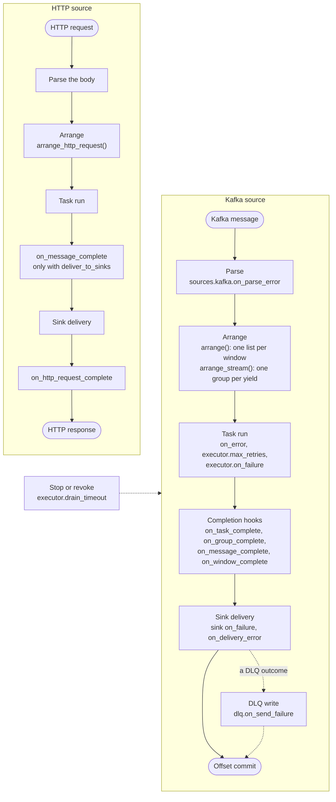

# Pipeline Map

A worker gets its input in one of three forms: Kafka messages turned into
tasks by [`arrange()`](handler.md#arrange-required), Kafka messages streamed
in groups by [`arrange_stream()`](fan-out.md#streaming-a-large-message), or
HTTP requests turned into tasks by
[`arrange_http_request()`](webapp.md#handler-hooks). This page shows, for
each form, the path of a message from the source to the commit, which hooks
run on that path and when, and what happens at each step when something
fails.

Choose a form to see which hooks run. Choose a step to see what can fail
there, which hook or config key decides, and what happens to the message and
its offset. Your choice is kept in the address of the page, so a link shows
the same view.

<noscript>

The map needs JavaScript. Without it, the reference tables below show the same facts.

</noscript>

## The path at a glance

## Reference tables

The same facts as the map, for every form and every step.

<!-- pipeline-map-tables:start -->

### Hooks of each input form

#### Kafka source with arrange()

The partition loop takes a window of messages and `arrange()` returns every task of the window as one list.

| Hook | Runs | Receives | Kept in memory until it runs |
|---|---|---|---|
| `arrange` | per window | The messages of the window and a `PendingContext` with the tasks that still wait. | The messages of the window. |
| `on_error` | per failed task run | The task and an `ExecutorError` with `kind`, `exit_code` and `stderr`. | The task with its stdin, until its last outcome. |
| `on_task_complete` | per task that succeeded | One `ExecutorResult`: the task, stdout and stderr. | The output of that one task, until the hook and its delivery end. |
| `on_message_complete` | per message | A `MessageGroup` with the tasks, results and errors of the message. | Every result and error of the message, only when the handler class overrides the hook. |
| `on_window_complete` | per window, after the offsets of its messages completed | The results and the source messages of the window. | Every result of the window, only when the handler class overrides the hook. |
| `on_delivery_error` | per failed attempt of one sink | A `DeliveryError` with the payloads, `attempt`, `retries_left` and `declared_policy`. | The payloads of the failed sink. |

- `executor.window_size` caps the messages of one window; the window size adapts to the free room in the pending budget.
- The framework sees the tasks of a message only after `arrange()` returned them, so one message can pass the pending limits by its own size.

#### Kafka source with arrange_stream()

The partition loop takes one message at a time. `arrange_stream()` is an async generator; each `yield` gives one group of tasks, and the next group is pulled only when the pending budget has room.

| Hook | Runs | Receives | Kept in memory until it runs |
|---|---|---|---|
| `arrange_stream` | per message; one group per `yield` | One message. There is no `pending` parameter. | The message and the generator, until the stream ends. |
| `on_error` | per failed task run | The task and an `ExecutorError`. A replacement joins the group of the task it replaces. | The task with its stdin, until its last outcome. |
| `on_task_complete` | per task that succeeded | One `ExecutorResult`; `result.task.group` is the group of the task. | The output of that one task, until the hook and its delivery end. |
| `on_group_complete` | per group, after the hooks and deliveries of its tasks | The `TaskGroup`, the results and the errors of the group. | The results and errors of the group, only when the handler class overrides the hook. |
| `on_message_complete` | per message, after every group hook and its delivery | A `MessageGroup` whose `groups` holds the groups; `tasks`, `results` and `errors` are empty. | One small `TaskGroup` per group: counters, labels and notes, never a task or an output. |
| `on_delivery_error` | per failed attempt of one sink | A `DeliveryError` with the payloads, `attempt`, `retries_left` and `declared_policy`. | The payloads of the failed sink. |

- `executor.window_size` has no effect, and `on_window_complete()` is refused at startup.
- The pending limits are passed by at most one group for each message that streams, so the size of your groups bounds the memory.
- The offset completes only when the whole message ends, so a replay runs the message from its start and the sinks receive the finished groups again.

#### HTTP source with arrange_http_request()

Each HTTP request becomes one virtual message. `arrange_http_request()` returns every task of the request, they run at the same time, and the answer goes back in the HTTP response. There is no offset.

| Hook | Runs | Receives | Kept in memory until it runs |
|---|---|---|---|
| `arrange_http_request` | per request | The parsed request body and an empty `PendingContext`. | The request body. |
| `on_message_complete` | per request, only with `sources.http.deliver_to_sinks: true` | A `MessageGroup` with the tasks, results and errors of the request. | Every result and error of the request, until the response. |
| `on_delivery_error` | per failed attempt of one sink, only with `sources.http.deliver_to_sinks: true` | A `DeliveryError` with the payloads, `attempt`, `retries_left` and `declared_policy`. | The payloads of the failed sink. |
| `on_http_request_complete` | per request, after the sink delivery | A `MessageGroup` with the tasks, results and errors of the request. | Every result and error of the request, until the response. |

- The HTTP path does not call `on_task_complete` or `on_error`, and it never retries a task.
- A request never waits for room in the pending budget, but its tasks count in it while they run.

### What can fail at each step

| Offset word | Meaning |
|---|---|
| **commits** | The offset completes when the message ends, and the commit moves past the message. |
| **stalls** | The offset is held and the partition is paused. Nothing is fetched from it until a restart or a reassignment; then the message is read again. |
| **replays** | The offset is not committed. The next owner of the partition reads the message again from its start. |
| **pending** | The offset stays pending in this process, so the partition commits nothing past it. The partition goes on with the next messages, unless the error marks it dead; after a restart or a rebalance the message is read again. |

#### Parse

The message value is parsed into the handler's input model.

Decided by: `sources.kafka.on_parse_error` (Kafka + arrange, Kafka + arrange_stream).

| When | Form | What happens | Offset or response | Record |
|---|---|---|---|---|
| The value fails parsing and `on_parse_error` is `skip`, the default. | Kafka + arrange, Kafka + arrange_stream | The arrange hook gets the message with `payload` set to None and `parse_error` set. The handler decides what to do with it. | **commits** | Nothing from the framework. |
| The value fails parsing and `on_parse_error` is `dlq`. | Kafka + arrange, Kafka + arrange_stream | The message is left out of the arrange hook. One DLQ record with `dk-stage: parse` is written. When the record cannot be written, the DLQ write step decides. | **commits** | DLQ record; `message_dlq` event and log line. |
| The value fails parsing and `on_parse_error` is `raise`. | Kafka + arrange, Kafka + arrange_stream | The error ends the partition loop. The first error restarts the loop, and the loop goes on with the next messages. A second error marks the partition dead, and `/readyz` fails. | **pending** | `partition_processor_restarting`, then `partition_processor_died` (critical); `drakkar_partition_processor_deaths_total`. |
| The request body is missing, too large, does not arrive in time, or fails validation against the request model. | HTTP | The request is refused before any hook runs. | HTTP 422 `invalid_request`, 413 `request_too_large`, or 408 `request_timeout` when the body does not arrive in time. | The HTTP response. |

#### Arrange

The arrange hook turns the input into tasks.

Decided by: `arrange` (Kafka + arrange), `arrange_stream` (Kafka + arrange_stream), `arrange_http_request` (HTTP).

| When | Form | What happens | Offset or response | Record |
|---|---|---|---|---|
| `arrange()` raises. | Kafka + arrange | The error ends the partition loop. The first error restarts the loop, and the loop goes on with the next windows. A second error marks the partition dead, and `/readyz` fails. | **pending** | `partition_processor_restarting`, then `partition_processor_died` (critical). |
| The generator raises, or yields a value that is not a list of tasks, a task with other source offsets, or a task object it already yielded. | Kafka + arrange_stream | No further group is pulled and the generator is closed. The groups that already started run to their end, with their hooks and deliveries; `on_message_complete` does not fire. Then the error is handled as a raise of `arrange()`: the first error restarts the partition loop and the loop goes on with the next messages; a second error marks the partition dead. | **pending** | `arrange_stream_failed`, then `partition_processor_restarting` or `partition_processor_died`. |
| The generator yields an empty list, or ends without a group. | Kafka + arrange_stream | An empty list is ignored: no group, no hook, no event. A stream that yields nothing is a message with no tasks: `on_message_complete` fires with no groups. | **commits** | Nothing. |
| A group arrives that is larger than `executor.max_pending_tasks`. | Kafka + arrange_stream | This is not a failure. The group is admitted when its turn comes, runs, and the stream goes on. | **commits** | `drakkar_stream_group_tasks` shows the group size. |
| `arrange_http_request()` raises. | HTTP | No task runs. The traceback goes to the log and never to the client. | HTTP 500 with `status: error`. | `webapp_arrange_http_request_failed`. |

#### Task run

Each task runs as a subprocess in the executor pool.

Decided by: `executor.task_timeout`, `on_error` (Kafka + arrange, Kafka + arrange_stream), `executor.max_retries` (Kafka + arrange, Kafka + arrange_stream), `executor.on_failure` (Kafka + arrange, Kafka + arrange_stream).

| When | Form | What happens | Offset or response | Record |
|---|---|---|---|---|
| The task runs longer than `executor.task_timeout`. | Kafka + arrange, Kafka + arrange_stream | The whole process group of the task is killed. The task fails with `kind: timeout`, and `on_error` decides as for any failure. | **commits** | `task_failed` event; `drakkar_executor_timeouts_total`. |
| `on_error` returns `RETRY` and retries are left. | Kafka + arrange, Kafka + arrange_stream | The same task runs again at once, with no backoff. A task runs at most `executor.max_retries` + 1 times. | **commits** | One `task_failed` event per failed run; `drakkar_task_retries_total`. |
| `on_error` returns `SKIP`, or the default hook runs with `executor.on_failure: skip`. | Kafka + arrange, Kafka + arrange_stream | The task is a terminal failure. The other tasks go on, and the completion hooks see the task in their errors. | **commits** | `task_failed` event. |
| `on_error` returns `DLQ`, or the default hook runs with `executor.on_failure: dlq`. | Kafka + arrange | The DLQ record of the task's source message is written at once, with `dk-stage: execute`. The message is done: tasks that already run finish, and no later result of the message is delivered. | **commits** | DLQ record; `message_dlq` event and log line. |
| `on_error` returns `DLQ`, or the default hook runs with `executor.on_failure: dlq`. | Kafka + arrange_stream | The DLQ record of the message is written at once, with `dk-stage: execute`. The message is done: no further group is pulled, the generator is closed, the running groups finish, and no later result of the message is delivered. | **commits** | DLQ record; `message_dlq` event and log line. |
| `on_error` returns a list of tasks. | Kafka + arrange | The new tasks replace the failed one in the same message. They count in `executor.max_pending_tasks`. Copy `source_offsets` onto each of them. | **commits** | `parent_task_id` on each new task. |
| `on_error` returns a list of tasks. | Kafka + arrange_stream | The new tasks replace the failed one in the same group, and always get its source offsets. They count in `executor.max_pending_tasks`. | **commits** | `parent_task_id` on each new task. |
| `on_error` returns `RETRY` when no retry is left. | Kafka + arrange, Kafka + arrange_stream | `executor.on_failure` applies: `skip` makes the task a terminal failure, `dlq` writes the record. | **commits** | `max_retries_exceeded` warning with `action`. |
| `on_error` raises. | Kafka + arrange, Kafka + arrange_stream | The exception is contained, and `executor.on_failure` applies. | **commits** | `on_error_hook_failed`; `drakkar_handler_hook_errors_total{hook="on_error"}`. |
| A task fails: a non-zero exit, a timeout, or a launch error. | HTTP | The failure is terminal at once: the HTTP path does not call `on_error` and never retries. `on_http_request_complete` sees the task in `group.errors`. | The response lists the task in `tasks` and counts it in `task_summary`. | `task_failed` event. |

#### Completion hooks

The completion hooks turn outcomes into sink payloads.

Decided by: `on_task_complete` (Kafka + arrange, Kafka + arrange_stream), `on_group_complete` (Kafka + arrange_stream), `on_message_complete`, `on_window_complete` (Kafka + arrange), `on_http_request_complete` (HTTP).

| When | Form | What happens | Offset or response | Record |
|---|---|---|---|---|
| `on_task_complete` raises. | Kafka + arrange, Kafka + arrange_stream | The task becomes a terminal failure with `kind: internal`. Nothing is delivered for it, and `on_error` is not called. | **commits** | `unexpected_error_in_task` with the traceback. |
| `on_group_complete` raises. | Kafka + arrange_stream | The raise is logged and ignored, and the group counts as finished. The stream and the other groups go on. | **commits** | `on_group_complete_failed`; a `group_complete` event with `output_message_count` 0. |
| `on_message_complete` raises. | Kafka + arrange, Kafka + arrange_stream | The raise is logged and ignored. Nothing is delivered for the message result. | **commits** | `on_message_complete_failed`. |
| `on_window_complete` raises. | Kafka + arrange | The raise is logged and ignored. The offsets of the window's messages completed before the hook ran. | **commits** | `on_window_complete_failed`. |
| `on_message_complete` or `on_http_request_complete` raises. | HTTP | The request fails. The traceback goes to the log and never to the client. | HTTP 500 with `status: error`. | `webapp_on_message_complete_failed` or `webapp_on_http_request_complete_failed`. |

#### Sink delivery

The payloads of a result go to their sinks, in parallel unless each sink's `depends_on` orders them. The failure policy keys of `sinks.defaults` apply to every sink that does not set its own.

Decided by: `sinks.defaults.on_failure`, `sinks.defaults.max_retries`, `sinks.defaults.breaker_failures`, `sinks.<type>.*.depends_on`, `on_delivery_error`.

| When | Form | What happens | Offset or response | Record |
|---|---|---|---|---|
| `on_delivery_error` returns `RETRY` and retries are left. | Kafka + arrange, Kafka + arrange_stream | `deliver()` runs again with the whole original payload list, so payloads that landed the first time land again. | **commits** | `sink_delivery_retry`. |
| `on_delivery_error` returns `RETRY` and retries are left. | HTTP | `deliver()` runs again with the whole original payload list, so payloads that landed the first time land again. | Each failed attempt is listed in the sink summary under `errors`. | `sink_delivery_retry`. |
| `on_delivery_error` returns `RETRY` when no retry of the sink's `max_retries` is left. | Kafka + arrange, Kafka + arrange_stream | The sink's declared `on_failure` applies, as for `dlq` or `skip` below. | **commits** | `sink_retry_budget_spent` warning, at most one line per sink per minute. |
| `on_delivery_error` returns `RETRY` when no retry of the sink's `max_retries` is left. | HTTP | The sink's declared `on_failure` applies, as for `dlq` or `skip` below. | As for `dlq` or `skip` below. | `sink_retry_budget_spent` warning, at most one line per sink per minute. |
| A delivery fails for good and the sink's `on_failure` is `dlq`, the default. | Kafka + arrange | One DLQ record per source message, with `dk-stage: sink`. The message is done: no later delivery of it starts, and the hooks still run but their results are not delivered (`sink_not_started`, reason `message_dlq`). | **commits** | DLQ record; `message_dlq` event and log line. |
| A delivery fails for good and the sink's `on_failure` is `dlq`, the default. | Kafka + arrange_stream | One DLQ record with `dk-stage: sink`. The message is done and the stream is closed: no further group is pulled, the running groups finish, and their hooks run without delivery (`sink_not_started`, reason `message_dlq`). | **commits** | DLQ record; `message_dlq` event and log line. |
| A delivery of the request result fails for good and the sink's `on_failure` is `dlq`. | HTTP | One DLQ record for the request: the value is the raw request body. The sinks of the request that have not started do not start. | HTTP 200; the sink summary counts the payloads under `dlq`. | DLQ record with `dk-request-id`. |
| An `on_window_complete()` result fails for good with `on_failure: dlq`. | Kafka + arrange | A window result has no source message, so it acts as `skip`. Sinks that depend on this one do not start, reason `dependency_failed`. | **commits** | `window_delivery_not_dlq` warning; `drakkar_sink_deliveries_skipped_total`. |
| A delivery fails for good and the sink's `on_failure` is `skip`. | Kafka + arrange, Kafka + arrange_stream | The payloads of this sink are dropped. The other sinks deliver, and a sink that depends on this one still starts. | **commits** | `sink_delivery_skipped`; a `sink_error` event with `action: skip`; `drakkar_sink_deliveries_skipped_total`. |
| A delivery fails for good and the sink's `on_failure` is `skip`. | HTTP | The payloads of this sink are dropped. The other sinks deliver, and a sink that depends on this one still starts. | The payloads are counted in `attempted` only. | `sink_delivery_skipped`; a `sink_error` event with `action: skip`; `drakkar_sink_deliveries_skipped_total`. |
| The sink's circuit breaker is open. | Kafka + arrange, Kafka + arrange_stream | `deliver()` is not called and `on_delivery_error` is not asked. The declared `on_failure` decides at once: `dlq` writes a record with `dk-error: circuit open`, `skip` drops the payloads. | **commits** | `drakkar_sink_circuit_open`; `drakkar_sink_circuit_trips_total`. |
| The sink's circuit breaker is open. | HTTP | `deliver()` is not called and `on_delivery_error` is not asked. The declared `on_failure` decides at once: `dlq` writes a record with `dk-error: circuit open`, `skip` drops the payloads. | As for `dlq` or `skip` above. | `drakkar_sink_circuit_open`; `drakkar_sink_circuit_trips_total`. |
| A dependency in `depends_on` ended in `dlq`, or failed without a DLQ record. | Kafka + arrange, Kafka + arrange_stream | The dependent sink does not start: reason `message_dlq`, or reason `dependency_failed`. | **commits** | `sink_not_started` event; `drakkar_sink_deliveries_not_started_total`. |
| A dependency in `depends_on` ended in `dlq`, or failed without a DLQ record. | HTTP | The dependent sink does not start: reason `message_dlq`, or reason `dependency_failed`. | `<type>/<name>: not started` in the sink summary. | `sink_not_started` event; `drakkar_sink_deliveries_not_started_total`. |
| `on_delivery_error` raises. | Kafka + arrange, Kafka + arrange_stream | The raise is logged and the sink's declared `on_failure` applies. | **commits** | `delivery_error_hook_failed`. |
| `on_delivery_error` raises. | HTTP | The raise is logged and the sink's declared `on_failure` applies. | As for `dlq` or `skip` above. | `delivery_error_hook_failed`. |

#### DLQ write

A DLQ record is the last place a failed message can go.

Decided by: `dlq.on_send_failure`.

| When | Form | What happens | Offset or response | Record |
|---|---|---|---|---|
| A DLQ record cannot be written (the write fails or is not confirmed in time, or no DLQ sink exists) and `on_send_failure` is `drop`, the default. | Kafka + arrange | The message is lost and counts as processed. A later failure of the message counts nothing again. | **commits** | `dlq_failure_payloads_dropped` (critical); `drakkar_dlq_dropped_payloads_total`. |
| A DLQ record cannot be written (the write fails or is not confirmed in time, or no DLQ sink exists) and `on_send_failure` is `drop`, the default. | Kafka + arrange_stream | The message is lost and counts as processed. The stream is closed as for a DLQ outcome: no further group is pulled, and the running groups finish without delivery. | **commits** | `dlq_failure_payloads_dropped` (critical); `drakkar_dlq_dropped_payloads_total`. |
| A DLQ record or a delivery cannot be confirmed and `on_send_failure` is `stall`. | Kafka + arrange | The offset is held and the partition is paused. Backpressure never resumes it. A message that comes back may get a second record. | **stalls** | `offset_stalled_on_delivery_failure`; `partition_paused_on_stall`; `partition_stalled` event; `drakkar_delivery_stalled_offsets_total`. |
| A DLQ record or a delivery cannot be confirmed and `on_send_failure` is `stall`. | Kafka + arrange_stream | The message is marked as not delivered and the stream is closed; the running groups finish with their hooks, and when the message ends its offset is held and the partition is paused. Backpressure never resumes it. | **stalls** | `offset_stalled_on_delivery_failure`; `partition_paused_on_stall`; `partition_stalled` event; `drakkar_delivery_stalled_offsets_total`. |
| The record of a request cannot be written and `on_send_failure` is `drop`. | HTTP | The loss is logged and counted. With the DLQ off by configuration (no Kafka source and no `dlq.topic`), the loss is counted on `drakkar_dlq_unconfigured_drops_total` instead. | HTTP 200; the sink shows `failed, no DLQ record`. | `dlq_failure_payloads_dropped`, or `drakkar_dlq_unconfigured_drops_total`. |
| The record of a request cannot be written and `on_send_failure` is `stall`. | HTTP | The delivery stops. A request has no offset to hold, so the response is the only signal; prefer `drop` on a worker with only the HTTP source. | HTTP 200; every validated type of the sink summary shows `deliver_all_raised` and `delivered: 0`. | `webapp_sink_deliver_all_failed`. |

#### Stop or revoke

A stop or a partition revoke can come at any step.

Decided by: `executor.drain_timeout` (Kafka + arrange, Kafka + arrange_stream), `on_revoke` (Kafka + arrange, Kafka + arrange_stream), `sources.http.request_timeout` (HTTP).

| When | Form | What happens | Offset or response | Record |
|---|---|---|---|---|
| The tasks of the message end within `executor.drain_timeout`. | Kafka + arrange | The drain waits for them. Their hooks and deliveries run, and the final commit includes the message. | **commits** | Nothing extra. |
| The tasks of the message end within `executor.drain_timeout`. | Kafka + arrange_stream | A message whose stream has already ended drains as usual: the drain waits for its tasks, hooks and deliveries. | **commits** | Nothing extra. |
| Tasks still run when `executor.drain_timeout` ends. | Kafka + arrange, Kafka + arrange_stream | The tasks are cancelled. The message is read again by the next owner of the partition. | **replays** | The drain log lines of the stop. |
| The stream of the message is still open. | Kafka + arrange_stream | The stream is abandoned at once: the pull in progress is cancelled, then the tasks of the message, then the generator is closed. No further group hook, message hook or delivery runs, and the drain does not wait for the message. Groups that finished before the stop have already delivered. | **replays** | `arrange_stream_abandoned`. |
| A stop and a DLQ outcome of the message meet. | Kafka + arrange_stream | The DLQ outcome decides: the stream is ended, not abandoned. When its running tasks end within `executor.drain_timeout`, the offset commits and the next owner writes no second DLQ record. | **commits** | DLQ record. |
| Tasks of a stream that failed earlier still run. | Kafka + arrange_stream | They are cancelled at the stop, because their message can never complete in this process. The next owner of the partition runs the message again. | **replays** | `arrange_stream_tasks_cancelled`. |
| Messages wait in the partition queue and were never arranged. | Kafka + arrange, Kafka + arrange_stream | They are dropped from the queue at the stop. | **replays** | `drakkar_queued_messages_dropped_at_stop_total`. |
| The worker stops while requests arrive or run. | HTTP | New requests are refused at once. Requests in flight run on, bounded by `sources.http.request_timeout`. | HTTP 503 `shutdown` for new requests; HTTP 504 `timeout` for a request that runs out of time. | `drakkar_webapp_requests_total{status="shutdown"}`. |

<!-- pipeline-map-tables:end -->

## Related pages

- [Handler](handler.md): every hook and its signature.
- [Fan-out](fan-out.md): message groups, streaming and the offset rules.
- [Sinks](sinks.md): the failure policy, the circuit breaker and the DLQ.
- [Webapp](webapp.md): the HTTP source and its status codes.
- [Data Flow](data-flow.md): the full processing story, step by step.
