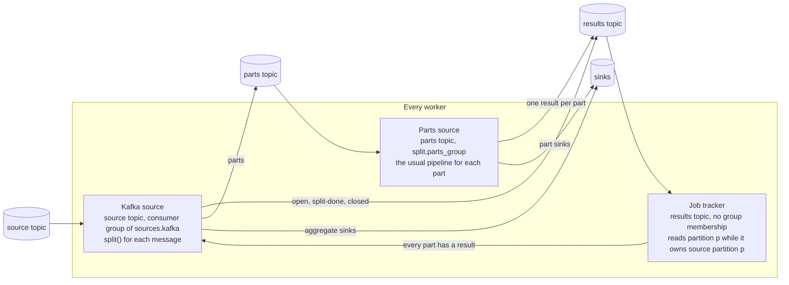

# Split a Message Across the Fleet

A handler can cut one source message into many small messages, the
**parts**. Every worker of the consumer group processes parts. The worker
that owns the original message waits until every part has a result, calls
one hook to put the results together, delivers that one answer, and only
then commits the offset of the original message.

The original message and everything that belongs to it is a **job**. The
worker that owns the source partition of the job is its **owner**.

The feature is **off by default**. A worker that does not turn it on
behaves as before.

A job can also start as an HTTP request: a client stores the request with a
`POST` and reads its status and result with a `GET`. See
[HTTP jobs](#http-jobs).

---

## When to use it {#when-to-use-it}

All tasks of one message normally run on one worker: the worker that owns
the partition of the message. That is right for almost every message.

Some messages are very large. One message can make 100 000 tasks. With
[`arrange_stream()`](fan-out.md#streaming-a-large-message) one worker
processes such a message with bounded memory, but it can take many hours,
and the other workers of the group are idle during that time.

Use split when both of these are true:

- One message can take longer on one worker than you accept.
- The work of the message can be cut into pieces that do not depend on each
  other. Each piece has the shape of an ordinary message.

`arrange_stream()` alone is enough when one worker can handle the largest
message in an acceptable time. It is simpler: no extra topics, no extra
consumer groups, and no extra hooks.

| | `arrange_stream()` | split |
|---|---|---|
| Where the tasks run | On the owner of the message | On every worker of the group |
| Extra topics | None | Two, which the operator creates |
| After a restart of the owner | Every group of the message runs again | Finished parts do not run again |
| Order of the work | Groups in the order you yield them | Parts have no order |
| Hooks of the end | `on_message_complete` | `aggregate` (and `on_message_complete` for each part) |

A handler can use both: `split` cuts a large message into parts, and
`arrange_stream()` turns each part into groups of tasks.

## How it works {#how-it-works}

Each worker with the feature on runs three readers.



The walk of one job. The owner of source partition 7 reads message M at
offset 500.

1. The owner calls `split(M)`.
2. The split yields nothing: M is a **local message**. It runs on the owner
   as an ordinary message, and the job ends with one call of `aggregate`.
   See [Local messages](#local-messages). Nothing is written to a topic.
3. The split yields parts. The owner writes an `open` record to partition 7
   of the results topic and waits for the broker to acknowledge it.
4. The owner publishes each part to the parts topic as the generator yields
   it, and then writes a `split-done` record with the number of parts.
5. The owner takes the next message of partition 7. It does not wait for
   the job.
6. Any worker reads a part from the parts topic. It runs `arrange()` or
   `arrange_stream()`, the tasks, `on_task_complete`, `on_group_complete`,
   `on_message_complete`, the part sinks and `part_data`, as for an ordinary
   message.
7. That worker writes a `result` record to partition 7 of the results topic,
   waits for the acknowledgement, and only then completes the offset of the
   part.
8. The job tracker of the owner reads the results and counts them.
9. When every part has a result, the owner calls `aggregate(job)`, delivers
   its answer to the aggregate sinks, writes a `closed` record, and
   completes offset 500. The usual commit follows.

The order at the end is always: aggregate sinks, then `closed`, then the
offset. The owner completes the offset when its job tracker has read the
`closed` record back from the results topic, which takes up to about one
second. The same holds for every record the owner writes for a job: it
decides the next step of the job only when its job tracker has read that
record back. When a delivery report names no offset for a record, the owner
reads the end of the results topic after the report and waits until its job
tracker has read up to that end; it decides nothing about the job while that
read is in progress. A wait that lasts 30 seconds is logged
(`split_read_back_waiting`), then at most once a minute for each partition.
The partition does not wait with the owner: after a split that failed, the
owner writes the DLQ record and the `closed` record, the partition takes its
next message, and the offset of the failed job completes when the `closed`
record is read back.

The offset of the job stays uncommitted while the job is open. Later
messages of partition 7 are processed meanwhile, but their offsets are not
committed until offset 500 completes. This is the usual watermark rule of
the offsets.

The results topic is the memory of the progress. When a worker restarts,
the progress is read back from it. When its records are lost, the original
message is still uncommitted, so it is split again. The worst case is
"run again", never "lost".

## A complete example {#a-complete-example}

A request carries a list of items. A request with more than 500 items is
split into parts of 100 items. Each task processes one item. Each item gets
one record in the part sink `kafka/item_results`. Each request gets one
summary in the aggregate sink `kafka/request_summaries`.

```python
from pydantic import BaseModel

import drakkar as dk

PART_SIZE = 100
LOCAL_LIMIT = 500


class Request(BaseModel):
    request_id: str
    items: list[str]


class ItemResult(BaseModel):
    request_id: str
    item: str
    exit_code: int


class PartSummary(BaseModel):
    items_done: int


class RequestSummary(BaseModel):
    request_id: str
    parts: int
    failed_parts: int
    items_done: int


class ItemHandler(dk.BaseDrakkarHandler[Request, ItemResult]):
    part_data_model = PartSummary

    async def split(self, message: dk.SourceMessage):
        request = message.payload
        if len(request.items) <= LOCAL_LIMIT:
            return  # a local message: it runs on this worker
        for start in range(0, len(request.items), PART_SIZE):
            yield request.model_copy(update={'items': request.items[start : start + PART_SIZE]})

    async def arrange(self, messages, pending):
        # Unchanged: a part has the shape of an ordinary message.
        return [
            dk.ExecutorTask(
                task_id=dk.make_task_id('item'),
                args=[item],
                metadata={'request_id': msg.payload.request_id, 'item': item},
                source_offsets=[msg.offset],
            )
            for msg in messages
            for item in msg.payload.items
        ]

    async def on_task_complete(self, result):
        meta = result.task.metadata
        record = ItemResult(request_id=meta['request_id'], item=meta['item'], exit_code=result.exit_code)
        return dk.CollectResult(kafka=[dk.KafkaPayload(sink='item_results', data=record)])

    async def part_data(self, group: dk.MessageGroup) -> PartSummary:
        # Runs on the worker that ran the part; the answer travels in the part result.
        return PartSummary(items_done=group.succeeded)

    async def aggregate(self, job: dk.SplitJob) -> dk.CollectResult | dk.JobAction | None:
        if job.failed_parts > 0:
            return dk.JobAction.DLQ
        items_done = 0
        async for result in job.results():  # reads the results topic; seconds for a large job
            if isinstance(result.data, PartSummary):
                items_done += result.data.items_done
        request = job.source_message.payload
        summary = RequestSummary(
            request_id=request.request_id,
            parts=job.total_parts,
            failed_parts=job.failed_parts,
            items_done=items_done,
        )
        return dk.CollectResult(
            kafka=[dk.KafkaPayload(sink='request_summaries', data=summary, key=request.request_id.encode())]
        )
```

The config:

```yaml
connections:
  kafka:
    main:
      brokers: "kafka:9092"

sources:
  kafka:
    enabled: true
    topic: requests
    consumer_group: item-workers
    on_parse_error: dlq        # a message that cannot be parsed never reaches split()

split:
  enabled: true
  aggregate_sinks: [kafka/request_summaries]
  job_timeout: 6h

sinks:
  kafka:
    item_results:
      topic: item-results
    request_summaries:
      topic: request-summaries
```

With these names the worker reads the parts topic
`requests_item-workers_split_parts` and the results topic
`requests_item-workers_split_results`. Create both before the worker
starts: see [The two topics](#the-two-topics).

The example reads every part result only to show the loop. Here
`job.tasks_succeeded` gives the same number with no read; see
[Reading the part results](#reading-the-part-results).

## The hooks {#the-hooks}

| Hook | Runs on | When | Returns |
|---|---|---|---|
| `split(message)` | the owner | once for each accepted source message, and again for each new attempt of a job after a restart or a takeover | an async generator: each `yield` is one part |
| `arrange()` or `arrange_stream()` | the worker that runs the part | as for an ordinary message | as for an ordinary message |
| `on_task_complete`, `on_group_complete`, `on_message_complete`, `on_window_complete` | the worker that runs the part | as for an ordinary message | a `CollectResult` for the part sinks, or `None` |
| `part_data(group)` | the worker that runs the part | after `on_message_complete` and its delivery | a small model, or `None` |
| `part_key(message, part, index)` | the owner | once for each part that `split` yields, before the part is published | an affinity key (`str` or `bytes`), or `None` |
| `aggregate(job)` | the owner | every part of the job has a result | a `CollectResult` for the aggregate sinks, `JobAction`, or `None` |
| `on_job_timeout(job)` | the owner | a timeout of the job fired | the same as `aggregate` |

The class attribute `part_data_model` names the model that `PartResult.data`
is parsed with on the owner.

### `split(message)`

- Write it as an async generator. Each `yield` gives one part: a pydantic
  model, written as its JSON, or `bytes`, written as they are. Any other
  value fails the job.
- A generator that ends before its first `yield` makes the message local.
- It is called after the message was accepted. `sources.kafka.on_parse_error`
  decides about a message that cannot be parsed before `split` runs. Under
  `skip` the hook gets a message whose `payload` is `None`.
- A raise fails the job: the original message goes to the DLQ with stage
  `split`. Parts that were already published still run, and their results
  are ignored.
- The generator is closed like the one of `arrange_stream()`: at most 5
  seconds, and `try`/`finally` works.
- The code before the first `yield` runs while the partition holds the
  reservation of its window in the pending budget, as `arrange()` does. Keep
  it short. After the first part the reservation is given back, so a long
  split does not hold the budget of other partitions.
- One job has at most 16 777 216 parts (part numbers 0 to 16 777 215). A
  split that yields more fails the job.
- At most 1000 published parts wait for their acknowledgement at one time.
  The split waits for the broker beyond that.
- A part larger than the broker accepts, or any other produce error that a
  retry cannot fix, fails the job.

### A part on the worker that runs it

A part is a `SourceMessage` of the parts topic:

| Field | Value |
|---|---|
| `topic` | The parts topic. |
| `partition`, `offset` | The real partition and offset in the parts topic. |
| `key` | The key of the original message. |
| `value`, `payload` | The part as `split` yielded it; `payload` is parsed with the input model of the handler. |
| `headers` | The headers of the original message without its `dk-` headers, then the split headers. |
| `request_id` | The request id of the original message. The `request_id` hook is not called for a part, so one id follows the request over the fleet. |
| `split` | A `SplitPart`: `group`, `source_topic`, `source_partition`, `source_offset`, `attempt`, `attempt_id`, `index`, `origin`, and the property `job_id`. It is `None` for an ordinary message and for a local message. |

A part is never split again: `split` is not called for it. The handler's
`on_assign` and `on_revoke` hooks are not called for partitions of the
parts topic; they tell about the source topic only.

### `part_data(group)`

Optional. It runs on the worker that ran the part, after
`on_message_complete` and its delivery, and gets the `MessageGroup` of the
part. Its answer travels in the part result, so keep it small: a few counts
or names. When the answer is larger than `split.max_part_data`, or the hook
raises, the data is dropped, `data_error` of the part result says why, and
the part still counts as finished. A raise also logs `part_data_failed`. It
runs for a local message too.

### `part_key(message, part, index)`

Optional. It gives a part an affinity key. The hook is synchronous. It runs
on the owner once for each part that `split` yields, before the part is
published. `part` is the object that `split` yielded, and `index` is the
part number.

- A part with a key goes to partition `crc32(key) mod N` of the parts topic.
  `crc32` is the unsigned CRC-32 of zlib, and `N` is the partition count of
  the parts topic. A `str` key is hashed as its UTF-8 bytes, so a `str` key
  and the `bytes` of the same text give the same partition.
- `None`, `''` and `b''` mean "no key". The part keeps the even spread. So
  one job can pin some parts and spread the others.
- A raise, or an answer that is not `str`, `bytes` or `None`, fails the job
  as a raise of `split` does: the original message goes to the DLQ with stage
  `split`.
- The key is not written into the part record. The record key stays the key
  of the original message, and the worker that runs the part does not see
  the affinity key.
- It is not called for a local message. It applies to Kafka jobs and HTTP
  jobs alike.

The hook runs on the event loop for every part, and a job can have many
thousands of parts. Keep it short: read a field of the part, and do no I/O.

### Keeping the parts of one entity on one worker {#part-key}

A worker can keep a local cache, for example the data of one customer. When
the parts of that customer go to different workers, each worker loads the
same data. Give such parts one key, and they go to one partition of the
parts topic. One worker of `split.parts_group` reads that partition, so its
cache stays warm.

```python
class CustomerHandler(dk.BaseDrakkarHandler[Request, Output]):
    async def split(self, message: dk.SourceMessage):
        for chunk in message.payload.chunks:
            yield chunk  # a model with a customer_id field

    def part_key(self, message: dk.SourceMessage, part, index: int) -> str | None:
        return part.customer_id or None  # no id: the part keeps the even spread
```

Know these limits before you use it:

- The affinity holds only while the consumer group of the parts keeps its
  assignment. A restart, a scale-up or a detach moves partitions. The cache
  of the new reader then starts cold.
- Parts with a key lose the even spread. A key that many parts share sends
  all of them to one worker, and that worker becomes the slowest part of the
  job.
- When you add partitions to the parts topic, the partition of every key
  changes.

### `aggregate(job)`

It runs on the owner when every part of the current attempt has a result,
in the scope of the partition's work, with the message context of the
original message. So the failure policy of an aggregate sink,
`on_delivery_error`, the DLQ and `dlq.on_send_failure` act as they do for
`on_message_complete`.

| Answer | What happens |
|---|---|
| a `CollectResult` | It is delivered to the aggregate sinks; then the job is closed. |
| `None` or `JobAction.DONE` | Nothing is delivered; the job is closed. |
| `JobAction.DLQ` | The original message goes to the DLQ; the job is closed. |
| a raise, or a value of another type | The original message goes to the DLQ with stage `aggregate`, and `aggregate_failed` is logged. |

The default `aggregate` returns `JobAction.DLQ` when `job.failed_parts` is
above 0, else `None`. So a handler without its own `aggregate` never
commits a message with a failed part. See
[When a part fails](#when-a-part-fails).

### `on_job_timeout(job)`

It runs on the owner when `split.job_timeout` or `split.idle_timeout`
fires. Its answer is handled as the answer of `aggregate`. The default
returns `JobAction.DLQ`. An override can accept a partial job:

```python
async def on_job_timeout(self, job: dk.SplitJob) -> dk.CollectResult | dk.JobAction | None:
    return await self.aggregate(job)
```

Every end through `on_job_timeout` closes the job as `timeout`, whatever the
hook answered.

### Startup checks

| Condition | Result |
|---|---|
| `split.enabled` is true and the handler does not override `split()` | the start fails |
| `split.enabled` is true and the handler overrides `part_data()`, `part_key()`, `aggregate()` or `on_job_timeout()`, or sets `part_data_model`, without `split()` | the start fails |
| `split.enabled` is true and `split()` is not an async generator function | the start fails |
| `split.enabled` is false | no split hook is checked: the worker starts and never calls them. A handler that has a `split()` method logs `split_disabled` once |

## `SplitJob` and `PartResult` {#splitjob-and-partresult}

`aggregate` and `on_job_timeout` get a `SplitJob`:

| Field | Meaning |
|---|---|
| `source_message` | The original `SourceMessage`. |
| `job_id` | The job as log lines show it: `<partition>:<offset>#<attempt>`, for example `7:500#1`. |
| `attempt` | The number of the current attempt, from 1. |
| `local` | `True` for a local message. |
| `total_parts` | The number of parts; `None` while the split has not finished (only after a timeout). |
| `received_parts` | How many parts have a result. |
| `failed_parts` | How many parts failed. |
| `dlq_parts` | How many parts ended in a `dlq` outcome. |
| `tasks_succeeded`, `tasks_failed`, `tasks_replaced` | Task counts, summed over the parts. |
| `deliveries` | For each part sink `<type>/<name>`: a `SinkCounts` with `delivered`, `skipped` and `failed`, summed over the parts. |
| `timed_out` | `''`, `job` or `idle`. |
| `opened_at` | Epoch seconds of the first `open` record of the job. |
| `duration_seconds` | Seconds since `opened_at`. |
| `missing_parts()` | The part numbers that have no result. It checks every part number in one go, so its time grows with the number of parts (about 3 seconds for 16 million parts). Call it in `on_job_timeout`, not for every job. |
| `results()` | An async iterator of the part results; see below. |

Each part result is a `PartResult`:

| Field | Meaning |
|---|---|
| `index` | The part number inside its job, from 0. |
| `worker` | The name of the worker that ran the part. |
| `outcome` | `ok`, or `failed` when the part did not run to a normal end. |
| `tasks_succeeded`, `tasks_failed`, `tasks_replaced` | Task counts of the part. |
| `deliveries` | Counts per part sink `<type>/<name>`: `delivered`, `skipped`, `failed`. |
| `dlq` | `None`, or a `PartDLQ` with `stage` (`execute` or `sink`), `sink`, `task_id`, `error` and `attempts` of the `dlq` outcome of the part. |
| `error` | The text of a parse failure, or of an error of `arrange` or of the stream. |
| `data` | The answer of `part_data`: a model of `part_data_model`, else a dict; `None` when there is none. Data that does not validate against `part_data_model` stays a dict. |
| `data_error` | Why the data was dropped, when it was. |
| `duration_seconds` | The run time of the part. |
| `finished_at` | Epoch seconds when the part finished. |

## Reading the part results {#reading-the-part-results}

The owner does not keep the part results in memory. It keeps counters and
one bit for each part, so a job of any size costs a few bytes for each part.
The counters are in the fields of `SplitJob`. When you need each result,
read them back:

```python
async def aggregate(self, job):
    total = 0
    async for result in job.results():  # reads the results topic; seconds for a large job
        if isinstance(result.data, PartSummary):
            total += result.data.items_done
    return dk.CollectResult(...)
```

What the loop does and costs:

- Each call of `job.results()` opens a short-lived consumer on the results
  partition of the job and reads from the first `open` record of the job to
  its last counted result. It yields the result of each part once, in log
  order, for the current attempt only.
- It reads the records of every other job of the partition in that range
  too, and drops them. For a large job it takes seconds.
- It gives the event loop a turn between batches.
- For a local message it yields the one result from memory.

So use the counters of `SplitJob` and the `data` of `part_data` for totals,
and read the list only when you need every part.

The loop can raise two errors:

| Error | When | What the framework does when it leaves the hook |
|---|---|---|
| `SplitResultsUnavailable` | The read fails: the broker does not answer, or no record arrives for 30 seconds. | It is not a failure of the hook. The job stays open and the hook is called again after 30 seconds, with a new `SplitJob`. After 20 such failures in a row the next one is handled as a raise of the hook. The failures log `split_results_unavailable`, at most once a minute. |
| `SplitResultsExpired` | The records of the job are gone: the first offset the broker still has is above the first `open` record of the job. | It is handled as a raise of the hook at once: a DLQ record with stage `aggregate`. Catch it in the hook to decide otherwise. |

## Local messages {#local-messages}

A message whose split yields nothing is a **local message**. It runs
through the pipeline of the owner in the same way as a part: `arrange()`,
the tasks, the completion hooks, the part sinks and `part_data`. Nothing is
written to the parts topic or the results topic. At its end the worker
builds one part result in memory and calls `aggregate` with a job of one
part (`job.local` is `True`, `job.total_parts` is 1).

So a handler has one rule: `on_message_complete` is for a part, and
`aggregate` is for an original message.

- Timeouts and attempts do not apply to a local message.
- Small messages do not wait behind the parts of a large job: they run on
  their worker at once.
- With the default `aggregate`, a local message with a failed part goes to
  the DLQ. One difference from a worker without the feature: a raise of
  `arrange` for a local message ends in a DLQ record of the original
  message. Without the feature it restarts the partition loop and leaves the
  offset pending.
- A window that holds a job gives its reservation of the pending budget
  back when the job publishes its first part, because a split can take
  minutes. The local messages of that window then pass the admission again:
  the loop waits for room and arranges as many of them as fit, then the
  rest. So `executor.max_pending_tasks` is passed by at most one message, as
  for any window.
- The end of a local message (`aggregate` and the aggregate sinks) runs
  beside the partition loop. The loop takes no further message while too
  many ends wait (twice `executor.window_size`, at least 16; the same cap
  as for finished parts that wait for their result). So a slow aggregate
  sink slows the partition down and does not pile up messages in memory.
- `drakkar_split_jobs_total` counts a local message with the outcome
  `local`, or `dlq` when it went to the DLQ.
  `drakkar_split_parts_processed_total` does not count it.

## When a part fails {#when-a-part-fails}

A part never stops its job and never writes a DLQ record. Everything that
happened goes into its result, and the owner decides at the end.

A part is `failed` when it did not run to a normal end:

| Cause | What the part result holds |
|---|---|
| The part cannot be parsed | `outcome` `failed`, `error` with the parse error. `sources.kafka.on_parse_error` does not apply to a part. |
| `arrange()` raises, or returns something that is not a list of tasks | `outcome` `failed`, `error`. Each part of the window gets such a result, and the partition loop goes on. |
| The stream of `arrange_stream()` fails | `outcome` `failed`, `error`, after the groups that started have ended. |
| A `dlq` outcome: a task under `executor.on_failure: dlq` or `ErrorAction.DLQ`, or a sink under `on_failure: dlq` | `outcome` `failed`, `dlq` with the facts the DLQ record would have had. No later delivery of the part starts, as for an ordinary message. |

A task that failed and was skipped does not make the part `failed`; it
counts in `tasks_failed`.

When `aggregate` (by default) answers `JobAction.DLQ`, one DLQ record of the
original message is written, with the original key, value and headers:

| Case | `dk-stage` and `dk-error` |
|---|---|
| The failed part with the lowest number has a `dlq` outcome | `dk-stage`, `dk-sink`, `dk-task-id`, `dk-error` and `dk-attempts` come from that outcome. The record looks as it does for an ordinary message. |
| The failed part with the lowest number has no `dlq` outcome | `dk-stage` `aggregate`, `dk-error` `part <n> failed: <error of that part>`. A `dlq` outcome of a later part is not used. |
| No part failed | `dk-stage` `aggregate`, `dk-error` `aggregate chose the DLQ: <failed> of <parts> parts failed`. |

`dk-delivered-sinks` names the part sinks that delivered a result of the
job, and the aggregate sinks that delivered before the record was written.

Other DLQ records of a job:

| Case | `dk-stage` | `dk-error` |
|---|---|---|
| `split` raised, yielded a value that is neither a model nor `bytes`, or a part could not be produced | `split` | `split failed: <error>` |
| The attempts are spent | `split` | `split did not finish in <n> attempts`; `dk-attempts` is the number |
| `aggregate` or `on_job_timeout` raised or returned a value of another type | `aggregate` | `<hook> failed: <error>` |
| The default `on_job_timeout` | `aggregate` | `job timed out after <duration>: <received> of <parts> parts`; `<parts>` is `?` when the split had not finished |

The parts of a job that has ended still run. They deliver to the part
sinks, and their results are ignored.

## Timeouts and attempts {#timeouts-and-attempts}

| Key | Default | Meaning |
|---|---|---|
| `split.job_timeout` | `24h` | The time since the first `open` record of the job. `0` is no limit. |
| `split.idle_timeout` | `0` | The time since the last new result of the job, or since `split-done`. It applies only after `split-done` of the current attempt: before it, the lack of results says nothing about a lost part. `0` is off. The time of a result is the later of two times: the time in its record, and the time at which the owner read it. So a worker whose clock is behind cannot make the timeout fire early. |
| `split.max_attempts` | `3` | How many attempts of one job may die during their split (no `split-done` and no `split-cancelled`) before the job goes to the DLQ. |

- The job tracker checks the open jobs every 5 seconds.
- The clock is the Kafka timestamp of the records, so a new owner continues
  the clock of the old one.
- A job whose every part has a result is never timed out: it is aggregated.
- A timeout during a split that still runs cancels the split.
- After a timeout the job is closed, and late results are ignored.
- A timeout of a restored job whose source message has not arrived yet
  waits for the message.
- `job_timeout` and `idle_timeout` cannot both be `0`: a job with a lost
  part would never end.

**How to choose `job_timeout`.** Measure the time of your largest job with
the whole fleet, and add room for a deploy and a broker outage. A job that
passes the timeout ends in the DLQ by default, so a timeout that is too
short sends healthy requests there. A timeout that is too long holds the
commits of the partition when a part is lost. The retention of both topics
must be longer than `job_timeout`.

**How attempts count.** A stop or a revoke that cancels a split writes
`split-cancelled`, and that attempt is not counted. So a rolling restart
cannot send a healthy request to the DLQ. When the `split-cancelled` write
does not get through before the worker stops (it waits at most 2 seconds),
the attempt counts. An attempt of another worker that a newer attempt
replaced, or that showed no end for 300 seconds, counts too. An attempt that
finished its split never counts. When `max_attempts` attempts died, the next
owner writes a DLQ record with stage `split` and closes the job as
`attempts_spent`.

With the default `3`, a job survives two owners that die during its split;
the third such death sends the message to the DLQ. With `1`, one restart of
the owner during a split (a crash, or a stop whose `split-cancelled` did not
get through) sends the message to the DLQ.

## Configuration {#configuration}

The root section `split`, after `sources` and before `executor`:

| Key | Default | Rule |
|---|---|---|
| `split.enabled` | `false` | Needs `sources.kafka.enabled`. |
| `split.connection` | `main` | A name under `connections.kafka`. |
| `split.parts_topic` | `''` | Empty: `<sources.kafka.topic>_<consumer group>_split_parts`. |
| `split.results_topic` | `''` | Empty: `<sources.kafka.topic>_<consumer group>_split_results`. |
| `split.parts_group` | `''` | Empty: `<sources.kafka.consumer_group>_split_parts`. |
| `split.results_group` | `''` | Empty: `<sources.kafka.consumer_group>_split_results`. |
| `split.aggregate_sinks` | `[]` | A list of `<type>/<name>` of configured sinks. |
| `split.job_timeout` | `24h` | `0`, or `1m` to `30d`. |
| `split.idle_timeout` | `0` | `0`, or `1m` to `30d`, and below `job_timeout` when both are set. |
| `split.max_attempts` | `3` | 1 to 10. |
| `split.max_part_data` | `64KiB` | `1KiB` to `512KiB`. |

- Each key has an environment form: `DK_SPLIT__` and the key in upper case,
  for example `DK_SPLIT__ENABLED=true` or `DK_SPLIT__JOB_TIMEOUT=6h`. No key
  is secret.
- With `enabled: false` the section loads and does nothing. Only its own
  values are checked then: the ranges, the two timeouts, and the form
  `<type>/<name>` of the `aggregate_sinks` entries. The rules that read
  other keys (the Kafka source, the connection, the configured sinks, the
  topics, the sink stages) apply only with `enabled: true`.
- The parts consumer takes its poll and session settings from
  `sources.kafka`.
- With `enabled: true` the source topic, the parts topic, the results topic
  and the DLQ topic must be four different topics; with `split.http.enabled`
  the status topic is a fifth, different from all of them.
- The checks run again after `on_startup`. A change of `split.enabled` in
  `on_startup` is ignored and logged, like the other settings that are read
  before `on_startup`.
- The config summary line has the token `split=on` or `split=off`, and
  `split=http` with [HTTP jobs](#http-jobs) on.
- The block `split.http` holds the keys of [HTTP jobs](#http-jobs-config).

The load messages are listed under
[Configuration](configuration.md#split-messages-split).

### Sink stages {#sink-stages}

With `split.enabled`, each sink belongs to one stage:

- an **aggregate sink** when `split.aggregate_sinks` names it;
- a **part sink** otherwise.

`depends_on` must stay inside one stage. A sink that depends on a sink of
the other stage fails the load:
`sinks.<type>.<name>.depends_on: '<ref>' is in the other split stage; a sink depends only on sinks of its own stage`.

A result that names a sink of the wrong stage is an error of the handler,
and nothing of it is delivered:

| Result | What happens |
|---|---|
| From `on_task_complete`, `on_group_complete` or `on_message_complete` of a part, naming an aggregate sink | The part gets a `dlq` outcome with stage `sink` and a fixed error text, and ends as failed. |
| From `on_window_complete` of a window of parts, naming an aggregate sink | Not delivered; `split_stage_error` is logged. |
| From `aggregate` or `on_job_timeout`, naming a part sink | Handled as a raise of the hook: a DLQ record with stage `aggregate`. |

## The two topics {#the-two-topics}

The operator creates both topics before the worker starts, as for the DLQ
topic. The worker only checks them.

| Topic | Default name | Partitions | Written by | Read by |
|---|---|---|---|---|
| Parts topic | `<sources.kafka.topic>_<consumer group>_split_parts` | At least as many as workers; more spreads the parts better | the owner | every worker, in `split.parts_group` |
| Results topic | `<sources.kafka.topic>_<consumer group>_split_results` | **Exactly** the partition count of the source topic | the owner and the workers that run parts | the owner of each source partition, and `job.results()` |

The part number `i` of a job goes to partition `(source offset + i) mod N`
of the parts topic, where `N` is its partition count, so the parts of one
job spread evenly. A part with an affinity key goes to partition
`crc32(key) mod N` instead (see [`part_key`](#part-key)). The records about a job of source partition `p` all go to
partition `p` of the results topic.

At start, with the feature on, the worker reads the topic metadata:

- A missing topic fails the start:
  `split: the topic '<topic>' does not exist; create it before the worker starts`.
- A results topic with another partition count fails the start:
  `split: the results topic '<topic>' has <n> partitions and the source topic '<topic>' has <m>; they must be equal`.
- A retention shorter than `split.job_timeout` logs the warning
  `split_topic_retention_short`. A retention that cannot be read (the
  worker may not describe topic configs) logs the same warning and never
  fails the start. With `job_timeout: 0` the retention is not checked.

**Retention.** Set the retention of both topics longer than the longest
job, and longer than `split.job_timeout`. A part that expires before a
worker reads it is lost, and its job ends by the timeout. A results record
that expires is lost too; when the records of a job are gone, a new owner
splits the message again as a new job.

**Partitions of the results topic** follow the source topic. Add partitions
to the results topic first, then the same number to the source topic.
Running workers take new source partitions without a restart. A message of
a source partition that has no results partition fails its split: it goes
to the DLQ, and the offset of that partition stalls. A worker that starts
between the two changes fails its start check, because the counts differ.

Example commands for a source topic with 12 partitions and up to 24
workers:

```bash
kafka-topics.sh --bootstrap-server=kafka:9092 --create \
  --topic=requests_item-workers_split_parts \
  --partitions=24 --replication-factor=3 \
  --config=retention.ms=172800000

kafka-topics.sh --bootstrap-server=kafka:9092 --create \
  --topic=requests_item-workers_split_results \
  --partitions=12 --replication-factor=3 \
  --config=retention.ms=172800000
```

`172800000` milliseconds is 2 days, longer than the `job_timeout` of `6h` in
the example.

### Consumer groups and access rules {#consumer-groups-and-access-rules}

A worker with the feature on uses three consumer group ids:

| Group id | Default | Used for | Rights |
|---|---|---|---|
| The source group | `sources.kafka.consumer_group` | the source topic, as before | as before |
| The parts group | `<sources.kafka.consumer_group>_split_parts` | a member of this group reads the parts topic | Read on the group and on the parts topic |
| The results group | `<sources.kafka.consumer_group>_split_results` | only stores the read positions of the results topic; it never has members | Read on the group and on the results topic |

The worker also needs Write on the parts topic and the results topic, and
Describe on both. DescribeConfigs on both topics lets it check the
retention; without it the worker logs a warning and starts.

The worker reports a topic it cannot see as missing: a topic that is not
in the topic list it reads fails the start with
`split: the topic '<topic>' does not exist`, also when the topic exists and
the worker has no right to describe it.

Two fleets with different source groups get different default topic names.
Every record also carries the source group, and a worker skips and counts
records of another group, so two fleets that an operator points at the same
topics do not mix their jobs.

## What a restart does {#what-a-restart-does}

The job tracker commits its read position of each results partition under
the results group: the first `open` record of the oldest job that is not
finished, or the next offset when there is none. After a restart, the new
owner reads the results partition from that position up to its end and
builds the table of jobs. This is the **restore**. The source partition
stays paused, and its processor does not start, until the restore of that
partition has ended. A job below the committed source offset is finished,
open or closed: a committed offset means done.

Then the source messages arrive again, from the committed offset:

| Case | What happens |
|---|---|
| A worker that runs parts restarts | Kafka gives its parts to other workers. A part whose result was written is not run again: its offset completed only after the write. A part without a result runs again. A second result for one part is ignored. |
| The owner restarts after `split-done` | The new owner finds `open` and `split-done` of the current attempt. It does not call `split` and does not publish parts. It waits for the missing results. Results that arrived while no owner read them are already counted. |
| The owner restarts during the split | The new owner finds `open` without `split-done`. It starts the next attempt: a new `open`, a new call of `split`. Results of the old attempt are ignored. The parts of the old attempt that were already published still run and deliver to the part sinks. A clean stop wrote `split-cancelled`, which does not count against `split.max_attempts`; a crash does count. |
| The owner restarts between the aggregate sinks and `closed` | The new owner finds a complete job that is not closed. It calls `aggregate` again: the aggregate sinks receive the result twice. |
| The owner restarts between `closed` and the commit | The new owner finds `closed`. It completes the offset and calls no hook. |
| The source message of a restored job never arrives (it expired, or an operator moved the position) | When a later message of the partition is accepted, the job is closed as `orphaned`, with the warning `split_job_orphaned`. |

Later messages of the partition that were processed but not committed
while a job was open run again after a restart of the owner. Closed jobs
among them are skipped. Local messages run again.

A restore that fails (the broker does not answer) is tried again after 1,
2, 4 ... 30 seconds. The partition stays paused meanwhile, the gauge
`drakkar_split_restoring_partitions` shows it, and `split_restore_failed`
is logged at most once a minute. A stop or a revoke ends the wait.

### Two owners for a short time {#two-owners-for-a-short-time}

During a rebalance an old owner may not have noticed its revoke yet while
the new owner already holds the partition. Both hold the same source
message, and both follow the same results log, so they agree which attempt
is current:

- The later `open` in the log is the current attempt. An owner that is
  splitting stops its own split when another worker opens a newer attempt,
  keeps the message, and follows that attempt (`split_job_superseded`).
- Each owner that holds the message can end the job when every part has a
  result. Only one of them can commit; the commit of the old owner fails.
  The aggregate sinks may receive the result twice.
- A `closed` record of either owner completes the offset of the other with
  no hook.
- The end of a job works on one attempt, from the call of its hook to its
  `closed` record. When another worker opens a newer attempt meanwhile, the
  end still finishes on its own attempt: the hook sees that attempt's
  counters and results, and the aggregate sinks receive its answer. Its
  `closed` record names the older attempt, so the results topic still has
  the job as open (`split_job_end_superseded`). The owner does not complete
  the offset; it keeps the message and follows the newer attempt, and the
  aggregate sinks may receive a second result when that attempt ends. Such
  an end is not counted on `drakkar_split_jobs_total`.
- The same holds for a split that failed, and for a job whose attempts are
  spent: when a newer attempt of another worker is before the `closed`
  record in the results topic, the job goes on under that attempt. The DLQ
  record of the failure is written by then, so the request can have a DLQ
  record and a result.
- When the attempt that an owner follows is cancelled, the owner starts the
  next attempt itself. When it shows neither `split-done` nor
  `split-cancelled` for 300 seconds after its `open`, its worker is taken
  for dead and the owner starts the next attempt. That dead attempt counts
  against `split.max_attempts`.

## What can go wrong {#what-can-go-wrong}

| Case | What happens |
|---|---|
| A worker dies while it runs a part | Kafka gives the part to another worker. It runs again. A second result for one part is ignored. |
| A part makes the partition loop fail twice | That partition of the parts topic is dead (`/readyz` shows `1000000 + n`), and the job ends by its timeout. A part that makes the worker process exit goes to the next worker after each crash. |
| A part expired before a worker read it | The job ends by its timeout. |
| The result of a part cannot be written | It is tried again after 1, 2, 4 ... 30 seconds. The offset of the part stays pending meanwhile. A partition takes no new part once a few finished parts wait for their write (twice `executor.window_size`, at least 16). After a restart those parts run again. A topic or partition that does not exist stalls the offset and logs an error. |
| A part finishes while its worker stops or loses the partition | It still makes one attempt to write its result. |
| A delivery of a part sink cannot be confirmed under `dlq.on_send_failure: stall` | The offset of the part stalls, as for any message, and no result is written. The job ends by its timeout, or goes on after the worker restarts. |
| The owner dies after `split-done` | The new owner restores the job and waits for the missing results. No part runs again. |
| The owner dies during the split | The next attempt runs. Results of the old attempt are ignored. Its parts still run. |
| The split crashes its worker each time | After `split.max_attempts` attempts: a DLQ record with stage `split`, and the job closes as `attempts_spent`. |
| `split` raises, or a part cannot be produced | A DLQ record with stage `split`; the job closes as `split_failed`. Parts already published still run, and their results are ignored. |
| A new attempt of a job that the results topic already has yields nothing: after a restart or after a takeover (two releases of the handler disagree about one message) | The job fails with a DLQ record of stage `split` and the error `split failed: the split yielded no part for a job that has parts in the log`, and closes as `split_failed`. Parts of an earlier attempt may have run, so the message does not run as a local message too. |
| `aggregate` or `on_job_timeout` raises | A DLQ record with stage `aggregate`. The job closes as `dlq`, or as `timeout` when the hook was `on_job_timeout`. |
| The results cannot be read back in `aggregate` | The job stays open. The hook runs again after 30 seconds, at most 20 times; then it is handled as a raise. Records that expired are a raise at once. |
| An aggregate sink fails | The policy of the sink decides, as always: retry, skip, or the original message to the DLQ. |
| The DLQ write fails | `dlq.on_send_failure` decides, as always: `drop` completes the offset, `stall` holds it. |
| The `closed` record cannot be written | It is tried again until it works or the worker stops; the offset completes only after it. A topic or partition that does not exist stalls the offset. |
| A result record has a part number or a counter that is not a whole number of 0 or more (a boolean, a text, a negative number) | The record is ignored and counted in `drakkar_split_results_ignored_total` with the reason `malformed`. A worker of this framework never writes one. |
| The owner dies between the aggregate sinks and `closed` | The new owner aggregates again: the aggregate sinks receive the result twice. |
| The owner dies between `closed` and the commit | The new owner reads the message again, finds `closed`, and completes the offset. |
| The source offset is committed and the job is still open in the log | The job is finished at the next restore. |
| The source message of a restored job never comes back | The job closes as `orphaned`, with a warning. This happens only when the source gave the worker a later message of the partition and never gave it this one (the message expired, or the position of the group was moved). |
| The worker received the message of a restored job and could not begin it: the message fails to parse, the partition loop failed in the middle of the window, or a stop came first | The job stays open and is never closed as `orphaned`. The next worker that receives the message goes on with the job. A message that fails to parse on every worker leaves its job open until the records of the job expire from the results topic. |
| A partition of the parts topic is stalled or dead on its worker | Every job that has a part in that partition waits for it. The job ends by its timeout, or goes on when another worker gets the partition. |
| A stop or a revoke cancels a split | `split-cancelled` is written. The next owner starts a new attempt, which does not count against `split.max_attempts`. |
| Two fleets with different source groups read one source topic | They use different default topic names, and records of another group are skipped. |
| The log records of a job expired | A new owner splits the message again as a new job. A live owner has the job in memory and goes on. |
| An old owner has not seen its revoke yet | Both owners follow the log. See [Two owners for a short time](#two-owners-for-a-short-time). |
| The broker is down | Parts, results and the job records wait. A part sink or an aggregate sink follows its own failure policy: with the defaults (30 s `delivery_timeout`, `on_failure: dlq`) an outage longer than the delivery timeout gives the part a `dlq` outcome, and the default `aggregate` sends the request to the DLQ. Raise `delivery_timeout` of the sinks above the outage you want to survive. The clocks go on, so a long outage can also fire a timeout of the job. |
| The fleet is too slow | The job ends by `job_timeout`. Set the timeout for the largest job. |
| Two releases of the handler run during a deploy | Parts that the old code made run on the new code. Keep the shape of a part compatible across releases. |

## Before you turn it on {#before-you-turn-it-on}

- **At-least-once.** A part can run twice, and the aggregate result can be
  delivered twice. Both part sinks and aggregate sinks must accept repeats,
  for example with a key that identifies the request.
- **Commits wait for the job.** While a job is open, later messages of its
  source partition are processed but not committed. After a restart of the
  owner they run again; closed jobs among them are skipped, local messages
  are not. The offset tracker keeps one entry for each such offset until the
  job ends.
- **A broker outage and the sinks.** The parts, the results and the job
  records wait for the broker. A Kafka sink does not wait longer than its
  `delivery_timeout`: with the defaults (30 s, `on_failure: dlq`) an outage
  longer than that gives the part a `dlq` outcome, and the default
  `aggregate` sends the whole request to the DLQ. Raise `delivery_timeout`
  of the part sinks and the aggregate sinks above the outage you want to
  survive.
- **Parts have no order.** Do not let one part depend on another.
- **The size of a part.** A part is the unit that runs again after a
  restart and the unit that spreads the load. Keep a part to a few minutes
  of work at most.
- **Partitions of the parts topic.** It needs at least as many partitions
  as workers, or some workers get no parts.
- **Retention.** The retention of both topics must be longer than the
  longest job.
- **One job after another.** The parts of a second large job wait behind
  the parts of the first in the parts topic.
- **Parts of an ended job still run.** After a timeout or a failure the
  parts that were already published run and deliver to the part sinks.
  Nothing cancels them.
- **The part shape across releases.** During a deploy, parts made by one
  release of the handler run on the other.

## Stop, revoke, detach and the debug pause {#stop-revoke-detach-and-the-debug-pause}

- A stop or a revoke does not wait for an open job. Its offset is left out
  of the drain, as for an open stream, so the final commits of the other
  offsets are not held.
- A stop or a revoke cancels a split in progress: the generator is closed
  and `split-cancelled` is written, together in at most a few seconds. The
  drain does not wait for it. An `aggregate` in progress may end within the
  drain time. When its `closed` record is written but not read back within
  half a second, the offset stays uncommitted: the next owner finds
  `closed` and completes the offset with no hook.
- The parts source drains as the Kafka source does.
- A [detach](detach.md) leaves both consumer groups, the source group and
  the parts group, and an attach joins both. The jobs of the worker move to
  the new owners through the results log.
- The [consume pause](consume-pause.md) also pauses the parts source.

## What the worker shows {#what-the-worker-shows}

### Partition numbers of the parts topic {#partition-numbers}

A partition of the parts topic has the same numbers as a partition of the
source topic. So everything the worker shows about partition `n` of the
parts topic uses the number **`1000000 + n`**: the `partition` label of
metrics, the `partition` field of log lines and recorder rows, the dead
partitions on `/readyz`, and the agent state part `partitions`. Partition 3
of the parts topic shows as `1000003`. `message.partition` of a part, as the
handler sees it, is the real number.

A part is recorded as the message it is: the `arranged`, task and
`message_complete` rows of the worker that ran it, under `1000000 + n` and
with the request id of the original message. So the Trace page finds the
work of one request on each worker.

The partition metrics, such as `drakkar_partition_queue_size` and
`drakkar_consumer_lag`, show the parts topic under `1000000 + n`. The
worker-level gauges without a partition label (`drakkar_assigned_partitions`,
`drakkar_backpressure_active`, `drakkar_total_queued`,
`drakkar_consumer_idle_seconds_total`,
`drakkar_executor_idle_slot_seconds_total`) describe the source topic only.

### Metrics {#metrics}

| Metric | Type | Labels | Meaning |
|---|---|---|---|
| `drakkar_split_jobs_open` | Gauge | -- | Split jobs this worker owns that are not closed. |
| `drakkar_split_oldest_job_age_seconds` | Gauge | -- | Age of the oldest open job this worker owns, `0` when there is none. A value close to `split.job_timeout` means a job is about to time out. |
| `drakkar_split_parts_expected` | Gauge | -- | Parts of the open jobs this worker owns whose split has finished. A job that is still splitting adds nothing. |
| `drakkar_split_parts_received` | Gauge | -- | Parts of those jobs that have a result. The gap to `drakkar_split_parts_expected` is the parts still running or waiting. |
| `drakkar_split_restoring_partitions` | Gauge | -- | Source partitions that wait for the restore of their jobs. |
| `drakkar_split_jobs_total` | Counter | `outcome` | Jobs ended, by outcome: `aggregated`, `dlq`, `timeout`, `split_failed`, `attempts_spent`, `orphaned`, `local` (a local message that did not go to the DLQ), and `superseded` (an attempt of this worker that another worker's newer attempt replaced; the job goes on). |
| `drakkar_split_job_duration_seconds` | Histogram | -- | Seconds from the first `open` record of a job to its end. Local messages are not counted. |
| `drakkar_split_parts_published_total` | Counter | -- | Parts published to the parts topic. A rise without new jobs means attempts are repeated. |
| `drakkar_split_parts_processed_total` | Counter | `outcome` | Parts of the parts topic this worker ran: `ok` or `failed`. Local messages are not counted. |
| `drakkar_split_results_received_total` | Counter | -- | Part results counted by the job tracker for jobs this worker owns. |
| `drakkar_split_results_ignored_total` | Counter | `reason` | Records ignored: `duplicate`, `old_attempt`, `closed_job`, `unknown_job`, `foreign_group`, `malformed`. The job tracker counts records of the results topic; a partition of the parts topic counts a part record it refuses (`foreign_group` or `malformed`). Repeats are normal after a restart. |
| `drakkar_split_result_write_failures_total` | Counter | -- | Failed attempts to write a part result. Alert on any rate. |
| `drakkar_split_restore_duration_seconds` | Histogram | -- | Seconds to restore the jobs of one source partition. |

`drakkar_handler_duration_seconds` has the `hook` values `split` (one
sample for each pull of a part, as for `arrange_stream`), `part_data`, `aggregate` and
`on_job_timeout`. `drakkar_dlq_records_total` has the `stage` values
`split` and `aggregate`.

### Log events {#log-events}

All events have the category `split`, except where the table says
otherwise. A line that can repeat is rate-limited and carries `suppressed`.

At start:

| Event | Level | Meaning |
|---|---|---|
| `split_enabled` | info | The feature runs. Fields `parts_topic`, `results_topic`, `parts_group`, `results_group`. |
| `split_disabled` | info | The handler defines `split` and `split.enabled` is false; `split` is never called. |
| `split_topic_retention_short` | warning | The retention of a topic is shorter than `split.job_timeout`, or could not be read. Field `detail`. |

The life of a job, on the owner:

| Event | Level | Meaning |
|---|---|---|
| `split_job_opened` | info | The `open` record of an attempt was acknowledged. Fields `partition`, `job`, `attempt`, `request_id`. |
| `split_job_done` | info | Every part was published and `split-done` was written. Fields `partition`, `job`, `parts`, `seconds`. |
| `split_attempt_started` | warning | A new attempt starts for a job that the results log already has: after a restart, a cancel or a takeover. Fields `partition`, `job`, `attempt`, `crashed_attempts`. |
| `split_job_resumed` | info | A restored job goes on with the arrival of its source message. Fields `partition`, `job`, `attempt`, `parts`, `received`. |
| `split_job_timed_out` | warning | A timeout fired; `on_job_timeout` runs. Fields `partition`, `job`, `kind` (`job` or `idle`), `received`, `parts`. |
| `split_job_closed` | info | The job is closed by the record of this worker. Fields `partition`, `job`, `outcome`, `parts`, `received`, `failed_parts`, `seconds`. |
| `split_job_closed_elsewhere` | info | Another worker closed a job whose message this worker holds; the offset completes with no hook. Fields `partition`, `job`, `outcome`. |
| `split_job_already_closed` | info | A source message arrived whose job the results topic already has as closed (the earlier owner stopped between its `closed` record and the commit); the offset completes with no hook. Fields `partition`, `job`, `outcome`. |
| `split_job_superseded` | warning | Another worker opened a newer attempt; this worker stopped its split and follows that attempt. |
| `split_job_end_superseded` | warning | Another worker opened a newer attempt before the `closed` record that this worker wrote for the job (after its end, a failed split, or spent attempts). The offset is not completed, and this worker follows the newer attempt. Fields `partition`, `job`. |
| `split_read_back_waiting` | warning | The job tracker has not read a record that this worker wrote for a job; the job waits for it. Written when a wait has lasted 30 seconds, then at most once a minute for each partition. Fields `partition`, `job` (`<partition>:<offset>`), `offset` (in the results topic, of the last record the job waits for), `seconds`, `suppressed`. |
| `split_end_offset_read_failed` | warning | A delivery report named no offset, and the end of the results topic could not be read; the read is tried again after 0.5 to 5 seconds, and the jobs of the partition wait for it. At most one line a minute for each partition. Fields `partition`, `error`, `suppressed`. |
| `split_job_orphaned` | warning | The source message of a restored job did not arrive; the job closes as `orphaned`. Fields `partition`, `job`, `received`, `parts`. |

Failures of a job, on the owner:

| Event | Level | Meaning |
|---|---|---|
| `split_failed` | error | The split raised, yielded a wrong value, could not publish a part, or the attempts are spent. A DLQ record with stage `split` follows. Fields `partition`, `job`, `error`. |
| `aggregate_failed` | error | `aggregate` or `on_job_timeout` raised, returned a value of another type, or named a part sink. A DLQ record with stage `aggregate` follows. Fields `partition`, `job`, `hook`, `error`. |
| `split_results_unavailable` | warning | `job.results()` could not read the results topic; the hook is called again after 30 seconds. Fields `partition`, `job`, `hook`, `error`, `failures`. |
| `aggregate_delivery_failed` | error | Category `sink`. The delivery of the aggregate answer could not be confirmed. |
| `aggregate_sink_delivery_failed` | error | Category `handler`. The delivery of the aggregate answer raised an unexpected error; `dlq.on_send_failure` decides (`offset_action`). |
| `split_publish_failed` | warning | A record of a split failed with an error that a retry can fix; it is sent again. |
| `split_closed_write_failed` | warning, or error with `final` true | A `closed` record could not be written. A warning while it is tried again; an error when it can never be written and the offset stalls. |
| `split_cancel_write_failed` | warning | The `split-cancelled` record of a cancelled split was not written; the attempt will count. |
| `split_close_failed` | error | The `split` generator did not close cleanly or in time. |
| `split_job_end_failed` | error | The end of a job raised an unexpected error; the offset stalls. |
| `split_owner_task_failed` | error | A task of the owner ended on an unexpected error. |
| `dlq_failure_payloads_dropped` | critical | The DLQ record of a job could not be written under `dlq.on_send_failure: drop`; the source message is lost. Also counted on `drakkar_dlq_dropped_payloads_total`. |

The part side:

| Event | Level | Meaning |
|---|---|---|
| `split_part_invalid` | warning | A record of the parts topic has no valid split headers, or is of another source group; it is skipped. Fields `partition`, `offset`, `reason`. |
| `split_part_arrange_failed` | error | `arrange()` raised for a window of parts; each part ends as failed. Fields `partition`, `offsets`, `error`. |
| `part_data_failed` | error | Category `handler`. `part_data` raised; the data is dropped. |
| `split_result_write_failed` | warning, or error with `final` true | A part result could not be written. A warning while it is tried again; an error when the topic or partition does not exist and the offset stalls. Fields `job`, `partition`, `part`, `error`, `final`, `attempt`. |
| `split_stage_error` | error | A result of `on_window_complete` for a window of parts named an aggregate sink; it is not delivered. |

The restore and the job tracker:

| Event | Level | Meaning |
|---|---|---|
| `split_restore_started` | info | The restore of a source partition starts. Fields `partition`, `position`, `end`, `attempt`. |
| `split_restore_finished` | info | The restore ended; the partition starts. Fields `partition`, `records`, `jobs`, `seconds`. |
| `split_restore_failed` | warning | A restore failed; it is tried again. Fields `partition`, `error`, `attempt`. |
| `split_restore_position_reset` | warning | The committed position is above the end of the results partition (the topic was created again or cut); the restore reads from the first record. |
| `split_restore_end_check_failed`, `split_restore_position_check_failed` | warning | A query of the end or of the position of a results partition failed during a restore; it is asked again. |
| `split_restore_task_failed` | critical | The restore of a partition ended on an unexpected error. The partition is not processed, and the worker fails `/readyz`. |
| `split_restore_pause_failed`, `split_restore_resume_failed` | error | The pause or the resume of a source partition around its restore failed. A resume is tried again after 1, 2, 4 ... 30 seconds. |
| `split_restore_cancel_slow` | warning | A revoke waited for restores that did not end in time. |
| `split_committed_offset_unknown` | warning | The committed offset of a source partition could not be read for a restore. |
| `split_release_failed` | warning | The tracker could not drop a revoked partition in time. |
| `split_tracker_consume_failed`, `split_tracker_seek_failed`, `split_position_commit_failed` | warning | A call of the tracker's consumer failed; it is tried again. |
| `split_tracker_unassign_failed` | warning | The tracker could not take a results partition off its consumer when the worker lost the source partition. It is not tried again: the partition is assigned anew when the worker gets the source partition back. Records of the partition that the consumer still reads meanwhile are ignored. |
| `split_tracker_unassign_not_needed` | debug | The same call failed for a partition whose assignment was cut short before it reached the consumer (a restore that was cancelled at once, as in the rebalances of a start). There was nothing to take off. |
| `split_closed_unreadable` | error | The job tracker could not apply the `closed` record that this worker wrote for a job (see `split_tracker_record_failed`), so the job table will never show it. The offset is not completed. After the first such record the owner ends the job once more, so the aggregate sinks can receive the result twice; after a second one the job stays open until its timeout or a restart. Fields `partition`, `job`, `offset` (of the record in the results topic, when it is known), `outcome`. |
| `split_tracker_record_failed`, `split_tracker_listener_failed`, `split_tracker_loop_failed`, `split_tracker_periodic_failed`, `split_tracker_task_failed` | error | An unexpected error in the job tracker; it is logged and the tracker goes on. |
| `split_tracker_close_failed` | warning | The tracker's consumer did not close cleanly at a stop. |

The split producer and the reader:

| Event | Level | Meaning |
|---|---|---|
| `split_producer_poll_failed` | error | The thread that serves the delivery reports of the split producer hit an error; it goes on. |
| `split_producer_close_incomplete` | warning | At a stop, records were still unsent when the time to flush them ended. Field `remaining`. |
| `split_results_reader_close_failed` | warning | The short-lived consumer of `job.results()` did not close cleanly. |
| `split_stop_failed` | warning | The stop of the split feature at the end of the worker's stop failed. |

### Troubleshooting {#troubleshooting}

- **`drakkar_split_restoring_partitions` stays above 0.** Read
  `split_restore_failed` lines: the broker does not answer, or the worker
  may not read the results topic or the results group. A restore can also
  wait when the whole rest of a results partition holds no record that a
  consumer returns. The worker writes such offsets only with a
  transactional producer, which it does not use; check whether another
  program writes to the results topic.
- **`drakkar_split_oldest_job_age_seconds` grows.** Look for parts that do
  not finish: `drakkar_split_parts_processed_total` on every worker, dead
  partitions of the parts topic (`1000000 + n`) on `/readyz`, and
  `split_result_write_failed` lines.
- **`drakkar_split_results_ignored_total{reason="foreign_group"}` grows.**
  Another fleet writes to the same topics. Give each fleet its own topics.

### For the operator {#for-the-operator}

**What to alert on.**

| Signal | What it says |
|---|---|
| `drakkar_split_result_write_failures_total` rises | Part results cannot be written to the results topic. Finished parts wait, and after a restart they run again. |
| `drakkar_split_restoring_partitions` is above 0 for minutes | A source partition is paused while its jobs are restored, and the restore does not end. Look for `split_restore_failed`. |
| `drakkar_split_oldest_job_age_seconds` is above 80 % of `split.job_timeout` | A job is close to its timeout. The fleet is too slow for it, or a part is lost. |
| A rate of `drakkar_split_jobs_total` with the outcome `timeout`, `attempts_spent`, `split_failed`, `dlq` or `orphaned` | Requests end without their aggregate result. Each of them has a DLQ record, except `orphaned`. |
| `drakkar_split_results_ignored_total` with the reason `foreign_group` or `malformed` | Another fleet or another program writes to the results topic of this fleet. |

**The progress of one job.** The Dashboard panel "Split jobs" of the
[operator UI](ui-reference.md#split-jobs-panel) and the route
`GET /api/v1/debug/split` show every open job. You can also use these:

- The log lines `split_job_opened`, `split_job_done` and `split_job_closed`
  of the owner. Each has the job id `<partition>:<offset>#<attempt>`, and
  the log context has the request id of the original message.
- The gauges `drakkar_split_jobs_open` and
  `drakkar_split_oldest_job_age_seconds` of the owner.
- The Trace page, by the request id or by the task label (see below), on
  each worker: every part keeps the request id of its original message, so
  each worker shows the parts it ran.

**Task labels.** A task of a part has the labels `split_job` (the job,
`<partition>:<offset>`, the same text as the job row) and `split_part` (the
number of the part). A task of a local message has `split_part=local`. The
Trace page finds all the tasks of one job with the label search
`split_job=<partition>:<offset>`.
Only a worker that runs split (`split.enabled: true` and a handler that
defines `split`) stamps these labels. A task built from several source
messages takes the labels of the first one.

**PromQL examples.**

```promql
# Parts still running or waiting, over the fleet
sum(drakkar_split_parts_expected) - sum(drakkar_split_parts_received)

# Open jobs
sum(drakkar_split_jobs_open)

# Age of the oldest open job, in seconds
max(drakkar_split_oldest_job_age_seconds)

# Jobs ended per second, by outcome
sum by (outcome) (rate(drakkar_split_jobs_total[5m]))
```

**The route.** `GET /api/v1/debug/split` answers for this worker: the
settings, the followed source partitions (`live` or `restoring`), and the
open jobs it follows (`limit` from 1 to 500, default 100; 422 for another
value; 503 when the main loop does not answer). With `split.enabled: false`
it answers `enabled: false` and no jobs. The agent surface has the state part
`split` and the diagnose rules `split-job-near-timeout` and
`split-partition-restoring`.
A job is near its timeout when its time left is below
`min(max(0.1 × T, 300 s), 0.25 × T)`, where `T` is `split.job_timeout` for a
job timeout and `split.idle_timeout` for an idle timeout: 10 % of the
timeout, at least 300 seconds, and never more than a quarter of the timeout.
The rule `split-job-near-timeout` and the health mark of the split panel in
the UI use this threshold.

**A replay of a DLQ record.** The replay tool publishes the original
message to the source topic again. It gets a new offset, so it is a new
job, and every part runs again. The part sinks can already hold results of
the first run: `dk-delivered-sinks` of the record names the part sinks that
delivered. Replay only when the part sinks accept repeats.

**A slow split holds its partition.** The partition loop of the owner
waits for the split of a message until `split-done` is written. A
generator that is slow between two parts holds every later message of that
source partition for that time. Keep the work of `split()` small: decide
the parts, and leave the heavy work to the parts.

## HTTP jobs {#http-jobs}

A client that speaks HTTP can start a split job too. A job of 100 000
tasks cannot be answered inside one HTTP round trip, and it must not be
lost when the worker that received it restarts. So the `POST` only
**stores** the request as one message in the source topic and answers with
an id. From there the message is an ordinary split job. The client asks a
`GET` with the id for the status and, at the end, for a small JSON result.

The feature is **off by default** (`split.http.enabled: false`). A worker
with the feature off does not change.

Checklist before you turn it on:

1. Create the status topic with `cleanup.policy=delete` and a retention of
   at least `split.http.result_retention`. Any partition count works. See
   [The status topic](#the-status-topic).
2. Upgrade every worker of the consumer group to a release with the
   feature first. Only then switch it on.
3. Set `split.http.enabled` and `split.http.status_topic` alike on every
   worker of the consumer group, also on workers that serve no HTTP. See
   [Mixed fleets and edges](#http-jobs-mixed-fleets).
4. Make sure that a request body fits in one Kafka record: lower
   `sources.http.max_body`, or raise the record limit of the broker and of
   the source topic. See [Mixed fleets and edges](#http-jobs-mixed-fleets).
5. Read the [known limits](#http-jobs-known-limits).

### How an HTTP job runs {#how-an-http-job-runs}

1. The client sends `POST <sources.http.path>` with the body of one source
   message.
2. The worker checks the body with the input model of the handler. It asks
   the `request_id` hook for the id. It writes the body as a message to the
   source topic, with the request id as the key, and waits for the broker
   to acknowledge the message.
3. It writes an `accepted` record to the status topic and answers `202`
   with the request id.
4. The owner of the source partition reads the message as any other
   message. It calls `split`, publishes the parts, and the fleet runs them.
   The `open` record of the job in the results log has `origin` `http`.
   While the job is open, the owner writes `running` records with the part
   counters to the status topic.
5. At the normal end the owner calls `aggregate`, then the new hook
   `http_job_result`, writes a `done` record with the result, waits for its
   acknowledgement, and then writes `closed`. Any other end writes a
   `failed` record.
6. Every worker with the feature on follows the status topic into memory.
   A `GET` on any worker that serves the HTTP source reads this map.

The source offset of an HTTP job completes only after the end state of the
job (`done` or `failed`) is acknowledged by the broker. A committed job
always has an end state that the client can read. The one
exception is a duplicate: see [The request id and
duplicates](#http-jobs-duplicates).

### Turn it on {#http-jobs-config}

| Key | Default | Rule |
|---|---|---|
| `split.http.enabled` | `false` | Needs `split.enabled`. |
| `split.http.status_topic` | `''` | Required when enabled. A topic that you create. |
| `split.http.result_retention` | `24h` | `1m` to `30d`. How long a client can read the status of an ended job. |
| `split.http.max_response` | `64KiB` | `1KiB` to `900KiB`. The largest result of one job, as JSON text. |

- Each key has an environment form, for example
  `DK_SPLIT__HTTP__ENABLED=true` or `DK_SPLIT__HTTP__STATUS_TOPIC=jobs-status`.
- The load fails with
  `split.http.enabled needs split.enabled: an HTTP job is a split job of the Kafka source`
  and with
  `split.http.enabled needs split.http.status_topic: name the topic that keeps the status of HTTP jobs`.
  The status topic must differ from the source, parts, results and DLQ
  topics. With `split.http.enabled: false` only the ranges of the block are
  checked.
- `split.http.enabled` does not need `sources.http.enabled`. A worker with
  the feature on and the HTTP source off serves no endpoint, but it owns
  jobs, writes their status records and keeps the status map.
- With the feature on and the HTTP source on, every `POST` on
  `sources.http.path` is a job. The hooks `arrange_http_request` and
  `on_http_request_complete` are not used, and the handler does not need
  them or the HTTP request and response types.
- The config summary line has the token `split=http`.
- At start the worker checks the status topic: a missing topic fails the
  start with `split: the topic '<topic>' does not exist; create it before the worker starts`.
  A retention shorter than `result_retention`, a cleanup policy with
  `compact`, or a setting that cannot be read logs the warning
  `split_topic_retention_short` with a `detail`. The worker still starts.

```yaml
sources:
  kafka:
    enabled: true
    topic: requests
    consumer_group: item-workers
  http:
    enabled: true
    path: /jobs
    deliver_to_sinks: false      # the default: an HTTP job writes to no sink
    clients:
      - name: tenant-a
        token: "${TENANT_A_TOKEN}"
        rpm: 60

split:
  enabled: true
  http:
    enabled: true
    status_topic: requests_item-workers_split_status
    result_retention: 24h
    max_response: 64KiB
```

```bash
kafka-topics.sh --bootstrap-server=kafka:9092 --create \
  --topic=requests_item-workers_split_status \
  --partitions=6 --replication-factor=3 \
  --config=cleanup.policy=delete \
  --config=retention.ms=172800000
```

`172800000` milliseconds is 2 days, longer than the `result_retention` of
`24h`.

### A complete example {#http-jobs-example}

The handler of [A complete example](#a-complete-example), with the result
hook. The client sends the body of a `Request` and reads a small summary.

```python
from pydantic import BaseModel

import drakkar as dk

PART_SIZE = 100
LOCAL_LIMIT = 500


class Request(BaseModel):
    request_id: str
    items: list[str]


class ItemResult(BaseModel):
    request_id: str
    item: str
    exit_code: int


class PartSummary(BaseModel):
    items_done: int


class JobAnswer(BaseModel):
    parts: int
    failed_parts: int
    items_done: int


class ItemHandler(dk.BaseDrakkarHandler[Request, ItemResult]):
    part_data_model = PartSummary

    async def split(self, message: dk.SourceMessage):
        request = message.payload
        if len(request.items) <= LOCAL_LIMIT:
            return  # a local message: it runs on this worker
        for start in range(0, len(request.items), PART_SIZE):
            yield request.model_copy(update={'items': request.items[start : start + PART_SIZE]})

    async def arrange(self, messages, pending):
        return [
            dk.ExecutorTask(
                task_id=dk.make_task_id('item'),
                args=[item],
                metadata={'request_id': msg.payload.request_id, 'item': item},
                source_offsets=[msg.offset],
            )
            for msg in messages
            for item in msg.payload.items
        ]

    async def part_data(self, group: dk.MessageGroup) -> PartSummary:
        return PartSummary(items_done=group.succeeded)

    async def http_job_result(self, job: dk.SplitJob) -> JobAnswer:
        # Runs on the owner after aggregate, only for an HTTP job that ended normally.
        items_done = 0
        async for result in job.results():  # one result for a local message, read from memory
            if isinstance(result.data, PartSummary):
                items_done += result.data.items_done
        return JobAnswer(
            parts=job.total_parts or 1,
            failed_parts=job.failed_parts,
            items_done=items_done,
        )
```

The default `aggregate` sends a job with a failed part to the DLQ, so the
client then reads `failed` with the outcome `dlq`.

A client session. The file `order-123.json` holds a `Request` with 600
items, more than `LOCAL_LIMIT`, so the job is split into 6 parts. The
answers are shown byte for byte: the status body has sorted keys, and
`result` comes last.

```bash
curl -s -X POST http://worker-1:8090/jobs \
  -H 'Authorization: Bearer <token of tenant-a>' \
  -d @order-123.json
# {"request_id":"req_20261123T101500_1a2b3c4d_0001","status":"accepted"}

curl -s -H 'Authorization: Bearer <token of tenant-a>' \
  'http://worker-2:8090/jobs?request_id=req_20261123T101500_1a2b3c4d_0001'
# {"parts":{"failed":0,"received":2,"total":6},"request_id":"req_20261123T101500_1a2b3c4d_0001","status":"running","updated_at":"2026-11-23T10:15:02.123456Z"}

# Later, when every part has a result:
# {"duration_seconds":29.4,"parts":{"failed":0,"received":6,"total":6},"request_id":"req_20261123T101500_1a2b3c4d_0001","status":"done","updated_at":"2026-11-23T10:15:31.500000Z","result":{"parts":6,"failed_parts":0,"items_done":600}}
```

A request with at most 500 items is a local message: it runs on the owner
and writes no `running` record, so a `GET` shows `accepted` and then `done`.

The id in the answer comes from the `request_id` hook. By default it is a
generated id. To let the client choose the id, override the hook, for
example to take the `request_id` field of the body or a request header
(see [The request id](webapp.md#the-request-id)).

### `POST <path>` {#http-jobs-post}

The gates run in the usual order of the HTTP source: `401`, `429` (the
`rpm` of the client), `503 shutdown`, `503 not_ready`, `408`, `413`, then
the body check (`422`) and the `max_concurrent` slot (`503 capacity`). Their
bodies are the ones of [Status codes](webapp.md#status-codes). `503
not_ready` has one more cause: the status map of this worker is not
restored yet (see [The status topic](#the-status-topic)). Its `error` is then
`webapp is starting; the status of HTTP jobs is not restored yet`.

Then:

1. The body is parsed with the input model of the handler (the first type
   parameter of `BaseDrakkarHandler`). A body that does not validate
   answers `422 invalid_request`. A handler with no input model takes the
   raw body as it is.
2. The `request_id` hook gives the id, with the same message as for an
   ordinary HTTP request: topic `__webapp__`, partition -1, offset 0, the
   raw body as value, the request headers, and the parsed body as payload.
   A hook that fails or answers an invalid id gives a generated id.
3. The id is looked up in the status map of this worker. A known id of the
   same client answers `200` with the status body of the `GET`, and
   nothing is written. A known id of another client answers `409`.
4. An unknown id: the body is written to the source topic, and the worker
   waits for the acknowledgement for at most `sources.http.request_timeout`.
5. The worker writes the `accepted` record and waits at most 5 seconds for
   it. The answer does not depend on that write.

A `POST` counts in `drakkar_webapp_inflight` while it runs, so a stop of the
worker waits for it in the drain of the HTTP source.

| HTTP | Body | `status` label of `drakkar_webapp_requests_total` | When |
|---|---|---|---|
| 202 | `{"request_id": "<id>", "status": "accepted"}` | `accepted` | The request is stored as a job. |
| 200 | The status body of the `GET` | `duplicate` | The id is known and belongs to this client. Nothing is written. |
| 409 | `{"error": "request_id_in_use", "request_id": "<id>"}` | `conflict` | The id is known and belongs to another client. |
| 413 | `{"error": "request_too_large", "request_id": "<id>", "details": "the request is larger than the broker accepts"}` | `error` | The broker refused the message as too large. |
| 503 | `{"status": "unavailable", "error": "the request could not be stored", "request_id": "<id>"}` | `unavailable` | Any other failure of the write, the time limit, or a main loop that did not answer in time. |
| 422 | `{"error": "invalid_request", "request_id": "<generated id>", "details": [...]}` | `error` | The body does not validate against the input model. |

A `503 unavailable` does not prove that nothing was stored: the message
can still reach the topic. Send the `POST` again with the same id. The
duplicate rule makes sure that only one job runs.

The `POST` writes these headers to the message, in this order, and no
other: `dk-origin` (`http`), `dk-request-id`, `dk-http-client` (the name of
the matched client) and `dk-deliver-sinks` (`true` or `false`). No header
of the client, and no token, reaches Kafka.

### `GET <path>?request_id=<id>` {#http-jobs-get}

The `GET` is authenticated like the `POST`. It is not counted by the `rpm`
limit and takes no `max_concurrent` slot: a poll is one read of a map in
memory. `503 shutdown` and `503 not_ready` apply.

| HTTP | Body | `status` label | When |
|---|---|---|---|
| 200 | The status body | `status_read` | The id is known and belongs to this client. |
| 404 | `{"error": "not_found", "request_id": "<id>"}` | `not_found` | The id is unknown, or belongs to another client. |
| 422 | `{"error": "invalid_request", "request_id": "<generated id>", "details": "request_id is required"}` | `error` | The parameter is missing or empty. |
| 503 | `{"status": "unavailable", "error": "the status could not be read", "request_id": "<id>"}` | `unavailable` | The main loop did not answer in time. |
| 503 | The `shutdown` body of the gates | `shutdown` | The worker started to stop while the read waited for an unknown id. |

An unknown id waits up to 1 second for a record of that id before the
`404`. So a `GET` that reaches another worker right after the `POST` does
not see a false `404`. An id of another client waits the same second, so
the time of the answer does not tell that the id exists. An id that breaks
the request id rule answers at once. When 1000 reads already wait, a new
read answers at once.

The status body:

```json
{"parts":{"failed":0,"received":412,"total":1000},"request_id":"order-123","status":"running","updated_at":"2026-11-23T10:15:02.123456Z"}
```

The keys are sorted. In a `done` body the `result` comes last, as the
handler's hook gave it.

| `status` | Fields besides `request_id`, `status` and `updated_at` |
|---|---|
| `accepted` | none |
| `running` | `parts`. `total` is `null` while the split has not finished. |
| `done` | `result` (the JSON of `http_job_result`, or `null`), `duration_seconds`, and `parts` when the job had parts |
| `failed` | `outcome`, `error` (a text, can be empty), and `parts` when they are known |

`updated_at` is the time of the record, in UTC with microseconds. The
`running` counters are written at most once every 5 seconds for one job,
so they can be a few seconds old.

The `outcome` of `failed`:

| `outcome` | Cause | `error` |
|---|---|---|
| `dlq` | The job or the local message went to the DLQ: `aggregate` answered `JobAction.DLQ` or raised, or an aggregate sink failed under `on_failure: dlq`. | Where it failed, from the `dk-stage` of the DLQ record: `a part failed in stage <stage>` (with ` at sink <type>/<name>` for the stage `sink`), `the job failed in stage aggregate`, `the message failed in stage <stage>` for a local message, or `an aggregate sink failed`. |
| `timeout` | `split.job_timeout` or `split.idle_timeout` fired. Every end through `on_job_timeout` is `timeout`, whatever the hook answered; `http_job_result` is not called. | The text of the timeout, also when `on_job_timeout` failed. |
| `split_failed` | `split` raised, yielded a wrong value, or a part could not be produced. | `split failed: <error>`. |
| `attempts_spent` | The attempts of the split are spent. | `split did not finish in <n> attempts`. |
| `orphaned` | The source no longer gives the message of a restored job. | `the source no longer gives the message of this job`. |
| `parse` | The message could not be parsed on the owner, under any `sources.kafka.on_parse_error`. With `dlq` the DLQ record is written too. | The parse error. |
| `response_failed` | `http_job_result` raised, its answer is not JSON, its JSON is larger than `split.http.max_response`, or the `done` record could not be written. The job itself ended normally. | Why. |
| `duplicate` | The message was dropped as a duplicate: an earlier message of the same partition has the same request id. No hook ran for it. The `job` of the record names the dropped message. Readers of the status still see the earlier job, because the lower offset wins. | `another request with this request_id was stored first`. |

`error` is cut to 2000 bytes, as `dk-error` of a DLQ record. The status never
holds task output: for the outcome `dlq` it names only the stage where the
job failed. The text of a failed task holds its stdout or stderr, and the
HTTP source never gives task output to a client. The DLQ record of the job
keeps the full text in `dk-error`.

### The result hook `http_job_result` {#http-job-result}

```python
async def http_job_result(self, job: dk.SplitJob) -> BaseModel | dict | list | str | int | float | bool | None:
    return None
```

- It runs on the owner after the answer of `aggregate` was acted on, only
  for an HTTP job that ends normally: the job would close as `aggregated`,
  or a local message did not go to the DLQ. It runs in the scope of
  `aggregate`: the message context of the original message, the request id
  in the log context, and the `hook` value `http_job_result` of
  `drakkar_handler_duration_seconds`.
- A pydantic model is dumped with `model_dump(mode='json')`. The answer is
  written as compact JSON; `NaN` and infinity are refused. A lone surrogate
  in a text, which has no UTF-8 form, is written as U+FFFD.
- A raise, an answer that is not JSON, or a JSON text larger than
  `split.http.max_response` (UTF-8 bytes) makes the status `failed` with
  the outcome `response_failed`, and logs `http_job_result_failed`. The job
  still closes as it ended: the aggregate sinks keep what they got, and
  nothing goes to the DLQ.
- It is called once per end. `SplitResultsUnavailable` from `job.results()`
  is not retried here, unlike in `aggregate`: it gives `response_failed` at
  once.
- `job.source_message.http_job` holds the request id and the client.
- The default answers `None`: the client reads `"result": null`.
- A handler that overrides it without `split.http.enabled` fails the start:
  `<Handler> overrides http_job_result() without split.http.enabled; it is called only for HTTP split jobs`.

The handler can tell an HTTP job in every hook:

| Where | Field |
|---|---|
| The original message | `message.http_job`: `None` for every other message, else an `HttpJob` with `request_id`, `client` and `deliver_sinks`. `message.request_id` is the id from the header; the `request_id` hook is not called again. |
| A part | `message.split.origin` is `http`, and `message.split.deliver_sinks` is the switch of the job. |

### Sinks of an HTTP job {#http-jobs-sinks}

The worker that receives the `POST` decides once for the job, by its
`sources.http.deliver_to_sinks` (default `false`). The decision travels in
the header `dk-deliver-sinks` and in the header `dk-split-sinks` of every
part, so the owner and every worker that runs a part follow it.

With the switch on, nothing differs from a job of the Kafka source.

With the switch off:

- Every hook runs as usual. The `CollectResult` of `on_task_complete`,
  `on_group_complete` and `on_message_complete` of a part or of a local
  message is dropped before delivery, and `PartResult.deliveries` stays
  empty. `part_data` runs.
- `on_window_complete`: a window result belongs to all messages of the
  window, not to one message. When one message of the window belongs to a job with
  the switch off, the whole window result is dropped, also the share of the
  other messages. Keep window results out of a handler that mixes such jobs
  with other messages, or use `on_message_complete`.
- A `CollectResult` of `aggregate` or `on_job_timeout` is checked for its
  stage as usual, and then dropped. The job ends as if it was delivered.
- The DLQ is not a sink of this switch. A `dlq` outcome of a task, a
  `JobAction.DLQ`, a parse failure, a failed split and a timeout write
  their DLQ records as usual.
- Each dropped result logs one debug line, `split_http_delivery_dropped`.

### The request id and duplicates {#http-jobs-duplicates}

The request id names the job for the client. The key of the message is the
id, so every message of one id goes to the same source partition and to the
same owner, in offset order.

Two `POST`s with one id can both be written: two workers at the same
moment, or a retry after a `503`. The duplicate rule:

- The worker that receives a `POST` refuses an id that its status map knows
  (`200` for the same client, `409` for another).
- The owner, before it begins an HTTP job message, waits until its status
  map is restored. A message whose id the map has with a lower offset of the
  same partition, or whose id the owner began at a lower offset since it got
  the partition, is a duplicate. No hook runs for it, and it logs
  `split_http_duplicate`. The owner writes a `failed` status for the job of
  the duplicate, with the outcome `duplicate`, and completes the offset only
  after the broker acknowledged that record. So the `accepted` record of the
  duplicate is never left alone in the status topic, and no later restore
  takes it for a job that never ends. Status readers still see the earlier
  job of the id, because the lower offset wins. When the status map does
  not hold the earlier job (the owner knows it only because it began it,
  for example after a `POST` whose time limit ended before its `accepted`
  record was written), the owner first writes the `accepted` record of the
  earlier job, with the client of that job, and waits for its
  acknowledgement. Only then does it write the `failed` record of the
  duplicate. So no client reads the final state of the duplicate while the
  earlier job runs. A stop during either write leaves the offset of the
  duplicate pending.
- The same message given again (the same offset) is the same job, not a
  duplicate. The one exception is a duplicate that is given again after
  its `failed` record was written: it is ended as a duplicate again. A job
  that the results topic already has is never a duplicate.
- An id is free again when its entry left the status map:
  `result_retention` after the end of its job. A `POST` with that id then
  starts a new job.

### The status topic {#the-status-topic}

One record for each change of a job:

| Part | Value |
|---|---|
| Key | The request id, UTF-8. The partition comes from the key partitioner. |
| Header | `dk-status-version` = `1`. |
| Value | Sorted compact JSON: `client`, `job` (`<source partition>:<source offset>`), `state` (`accepted`, `running`, `done` or `failed`), `updated_at`; `parts` (`failed`, `received`, `total`) for `running` and for an end state of a job with parts; `result` and `duration_seconds` for `done`; `outcome` and `error` for `failed`. |

```json
{"client":"tenant-a","job":"7:500","parts":{"failed":0,"received":412,"total":1000},"state":"running","updated_at":"2026-11-23T10:15:02.123456Z"}
```

Who writes what:

- The worker that received the `POST` writes `accepted`, best effort.
- The owner writes `running` after the `open` record of the job is read
  back, again when the split has finished, and then when a counter changed,
  at most once every 5 seconds for one job. These writes are best effort: a
  write that fails is counted and logged, and dropped.
- The owner writes the end state, `done` or `failed`. It tries it again
  after 1, 2, 4 ... 30 seconds until the broker acknowledges it. A stop
  ends the retries and leaves the offset pending, so the next owner ends
  the job. An end state that can never be written (the broker refuses it
  for good) stalls the offset. A `done` record that can never be written is
  first replaced by `failed` with the outcome `response_failed`.

Status records go through a producer of their own, on `split.connection`.
Its queue is bounded (10 000 records, 64 MiB), and a record that the broker
does not take within 30 seconds fails. So an outage of the status topic
fills only that queue. Parts, results, `open`, `closed` and the request
writes of the `POST` do not wait behind status records. While that queue
is full, an `accepted` or `running` record is dropped and counted. An end
state waits for room and is tried again as described above.

**The status map.** Every worker with the feature on runs a **status
follower**: one consumer that reads every partition of the status topic
from the beginning, with the group id of `split.results_group`. It only
assigns partitions and never commits. It keeps the best record of each
request id in memory. A new record of a known id:

1. Of another job: the record of the lower source offset wins. The same id
   gives the same key, so the same source partition: the lower offset is
   the first message of the id. The record of the other job is ignored.
2. Of the same job: the states rank `accepted`, then `running`, then `done`
   and `failed` (equal). A record of a lower rank is ignored; the same or a
   higher rank replaces the stored one.

So the map does not depend on the order in which the `accepted` record and
the records of the owner reach the topic. A record that cannot be read (not
JSON, another version, a missing or wrong field) is skipped and logs
`split_http_status_record_invalid`.

**Why `cleanup.policy=delete`.** Compaction keeps only the last record of a
key. The broker could keep a late `accepted` and delete the `done` that the
rank rule prefers. The client would then see the job as accepted for ever.

**Expiry.** An entry in an end state leaves the map `result_retention`
after its `updated_at`; a sweep runs every 60 seconds. An entry that has not
ended never leaves the map by time: its job is still somewhere. After a
restart the map holds only what the topic still has. Records in an end
state that are older than `result_retention` are not stored. Such a record
also removes the stored entry of its own job, and the map does not take a
lower-rank record of that job after it. So a job that ended before the
restart does not show `accepted` or `running` after the restore, and its
id can name a new job.

**The restore.** At start the follower reads every partition up to the end
it saw at that moment. Until then the `POST` and the `GET` of this worker
answer `503 not_ready`, `/readyz` names the reason
`split_http_status_not_restored`, and the owner waits before it begins an
HTTP job message. The partition returns its reservation to the pending
budget while it waits. The end of the restore logs
`split_http_status_restored` with the number of records and jobs. A restore
that fails is tried again after 1, 2, 4 ... 30 seconds. The restore reads
the whole topic, so it takes longer with a longer retention.

After the restore, the owner waits once more before each HTTP job message:
at most 5 seconds, until the follower has read up to the end of every
partition of the status topic as it is at that moment. A wait that cannot
read the end logs `split_http_status_catch_up_failed` (warning, at most once
a minute), and the owner goes on.

**Memory.** Every worker with the feature on holds the map, also a worker
without the HTTP source. Size it as:

    jobs kept = jobs per second × result_retention (plus the jobs that run)
    memory    ≈ jobs kept × (result size + a few hundred bytes)

For example, 2 jobs per second with `result_retention: 24h` keep 172 800
jobs. With results of 4 KiB that is about 700 MiB on every worker. When that
is too much, lower `result_retention` or `max_response`.
`drakkar_split_http_jobs` shows the entries by state.

**Access rights.** Besides the rights of the two split topics, the worker
needs Read and Describe on the status topic, Write on the status topic, and
Write on the source topic (the `POST` writes the request there).
DescribeConfigs on the status topic lets the start check read its retention
and cleanup policy.

### Mixed fleets and edges {#http-jobs-mixed-fleets}

- **A worker with the feature off.** A worker with `split.enabled` and
  `split.http.enabled: false` treats a message with `dk-origin: http` as an
  ordinary message of the source: the sinks are delivered and no status is
  written. It logs `split_http_message_unhandled`, at most once a minute.
  The client then sees `accepted` for ever. This is a config error of the
  fleet: set the feature alike on every worker of the consumer group.
- **An older release.** A worker of a release without the feature ignores
  `dk-split-sinks` when it runs a part, and delivers the part sinks.
  Upgrade every worker before you switch the feature on.
- **The size of a request.** `sources.http.max_body` (default `10MiB`) is
  larger than the record limit of a default broker (about 1 MB). Lower
  `max_body` to what the broker accepts, or raise `message.max.bytes` of the
  broker (or `max.message.bytes` of the source topic). A body that passes
  `max_body` and that the broker refuses answers `413`.
- **Time limits.** `sources.http.request_timeout` bounds the `POST`, not the
  job. `split.job_timeout` bounds the job.
- **Partitions of the source topic.** The duplicate rule needs every
  message of one id in one partition. Adding partitions to the source topic
  moves keys to other partitions, so a retry of an id that was sent before
  the change can start a second job.
- **A producer outside the framework.** A program that writes the four
  headers to the source topic creates an HTTP job; whoever can write to the
  source topic is trusted already. It must use the key partitioner of the
  framework (`consistent_random`, the CRC32 hash of the key), or two
  messages of one id can land in different partitions. Many clients use
  another hash by default.
- **A message with a bad request id.** A message with `dk-origin: http` and
  a `dk-request-id` that breaks the request id rule is an ordinary message
  of the source.
- **Detach, the consume pause, a rebalance.** Nothing new: the message is
  in the source topic, and the job moves with its partition.
- **The Message Probe.** It runs an HTTP job message as an ordinary
  message, as for every message of a splitting handler.
- **`sources.http.deliver_to_sinks`** keeps its old meaning on a worker
  without the feature.

### Known limits {#http-jobs-known-limits}

1. A `POST` whose time limit ends after the message was stored answers
   `503 unavailable`, although the job runs, and no `accepted` record is
   written for that job. A `GET` of the id answers `404` until the first
   `running` record or the end state of the job is read; `running` records
   are best effort. A second `POST` with the same id answers the existing
   status when the worker has one; else it is stored again, and the owner
   drops it as a duplicate after it wrote the `accepted` record of the
   first job (see [The request id and duplicates](#http-jobs-duplicates)).
2. Before it begins an HTTP job message, the owner waits up to 5 seconds
   until its status follower has read what the status topic holds at that
   moment. This covers a follower that lags behind and a new owner after a
   rebalance. A record that reaches the topic after that moment, or a
   follower that needs more than 5 seconds, can still let a second message
   of the same id run as a second job. After a wait that ran out of time or
   failed, the worker does not wait again for 30 seconds, so an outage of
   the status topic does not hold every partition for 5 seconds a message.
   In those 30 seconds the owner checks duplicates only with what its
   status map holds.
3. When two owners overlap after a rebalance, both can end the job. A
   client can then read `done` and later another end state of the same job:
   `done` and `failed` have the same rank, and the record that arrives last
   wins. A restart of the owner between `done` and `closed` also runs the
   end again: `aggregate` and `http_job_result` run a second time, and a
   second `done` is written.
4. `SplitResultsUnavailable` raised inside `http_job_result` gives `failed`
   with the outcome `response_failed` at once.
5. The status map lives in memory on every worker with the feature on. See
   **Memory** in [The status topic](#the-status-topic).
6. A job cannot be cancelled.
7. Two clients that `POST` the same new id at the same moment both get
   `202`, because neither worker has a status of the id yet. The message
   with the higher offset is dropped as a duplicate, and its client reads
   `404` for the id, or the status of the other job when it is the same
   client. Once the other job has left the status map, a read of the id can
   show the `failed` record of the dropped message, with the outcome
   `duplicate`, until that record leaves the map too.

### Metrics and log events of HTTP jobs {#http-jobs-observability}

| Metric | Type | Labels | Meaning |
|---|---|---|---|
| `drakkar_split_http_jobs_accepted_total` | Counter | -- | HTTP requests stored as split jobs. |
| `drakkar_split_http_status_reads_total` | Counter | `status` | Status reads by the answered status: `accepted`, `running`, `done`, `failed`, `not_found`. |
| `drakkar_split_http_jobs` | Gauge | `state` | Entries of the status map of this worker, by state. |
| `drakkar_split_http_status_write_failures_total` | Counter | -- | Status records that could not be written: each failed best-effort write, and each failed attempt of an end state. |

`drakkar_webapp_requests_total{status}` has the values `accepted`,
`duplicate`, `conflict`, `unavailable`, `status_read` and `not_found` on a
worker with the feature on. `drakkar_handler_duration_seconds` has the
`hook` value `http_job_result`.

Log events, category `split` unless the table says otherwise. A line that
can repeat is rate-limited to one a minute and carries `suppressed`.

| Event | Level | Meaning |
|---|---|---|
| `split_http_enabled` | info | The feature runs. Fields `status_topic`, `result_retention_seconds`. |
| `split_http_status_restored` | info | The status map is restored; the worker answers. Fields `records`, `jobs`, `seconds`. |
| `split_http_status_restore_failed` | warning | A restore of the status map failed; it is tried again. Fields `error`, `attempt`. |
| `split_http_status_catch_up_failed` | warning | The wait of the owner for the end of the status topic could not read the end; the owner goes on. Field `error`. At most once a minute. |
| `split_http_status_consume_failed` | warning | A read of the status topic failed; it is tried again after half a second. Field `error`. |
| `split_http_status_record_invalid` | warning | A record of the status topic cannot be read; it is skipped. Fields `partition`, `offset`. |
| `split_http_status_record_failed` | error | A record of the status topic hit an unexpected error; the next record is read. Fields `partition`, `offset`, `error`. |
| `split_http_status_loop_failed` | error | A loop of the status follower (`loop` is `read` or `sweep`) ended on an unexpected error; it starts again after 3 seconds. Fields `loop`, `error`. |
| `split_http_status_close_failed` | warning | The consumer of the status follower did not close cleanly at a stop. Field `error`. |
| `split_http_job_accepted` | info | A request is stored as a job. Fields `request_id`, `job` (`<partition>:<offset>`; `null` when the delivery report named no offset), `client`. |
| `split_http_store_failed` | warning | A request could not be stored in the source topic. Fields `request_id`, `client`, `error`. |
| `split_http_dispatch_failed` | warning | The HTTP source thread did not get an answer from the main loop in time, and answered `503 unavailable`. One line per route a minute. Fields `route` (`submit` or `status`), `request_id`, `client`, `timeout_seconds`, `error`. |
| `split_http_status_write_failed` | warning | A status record was not written. Fields `request_id`, `state`, `error`. |
| `split_http_duplicate` | info | The owner dropped a duplicate message with no hook call; it ends the job of the message with `failed`, outcome `duplicate`. Fields `partition`, `request_id`, `job`, `first_job` (`null` when the message is a duplicate given again after the earlier job left the status map). |
| `split_http_message_unhandled` | warning | A worker with the feature off got an HTTP job message and runs it as an ordinary message. Fields `partition`, `offset`. |
| `split_http_delivery_dropped` | debug | A result was dropped because its job writes to no sink. Fields `partition`, `request_id`. |
| `http_job_result_failed` | error | Category `handler`. `http_job_result` failed; the status is `failed` with `response_failed`. Fields `partition`, `job`, `error`. |

**Alert on** a rate of `drakkar_split_http_status_write_failures_total`
(end states wait, and their offsets with them), on `split_http_message_unhandled`
(a worker of the fleet has the feature off), and on
`drakkar_webapp_requests_total{status="unavailable"}`.

## What is not there yet {#what-is-not-there-yet}

- An HTTP job cannot be cancelled. The UI, the recorder and the agent
  surface do not show the request id or the status of an HTTP job yet.
- The Message Probe runs a message of a splitting handler as an ordinary
  message: it calls neither `split` nor `aggregate`.
- Queued parts of a job that has ended are not cancelled.
- A part is never split again.

## Related pages

- [Fan-out](fan-out.md): `on_message_complete` and `arrange_stream()`.
- [Handler](handler.md#splitting-a-message): the hook reference.
- [Sinks](sinks.md#dead-letter-queue): the DLQ record and its stages.
- [Configuration](configuration.md#split-messages-split): the `split` keys.
- [Observability](observability.md#split): the metrics reference.
